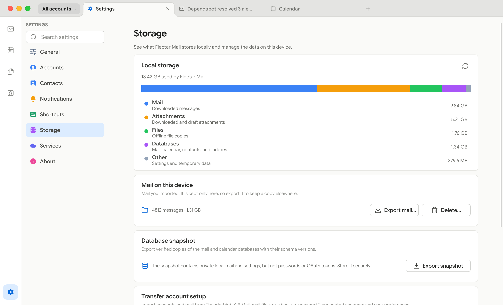

# Flectar Mail features

A closer look at what the [README](../README.md) summarizes.

- [Conversation threads](#conversation-threads)
- [Tabs](#tabs)
- [New-mail notifications](#new-mail-notifications)
- [Profiles and account colors](#profiles-and-account-colors)
- [Appearance](#appearance)
- [Frameless window](#frameless-window)
- [Calendar, contacts, and files](#calendar-contacts-and-files)
- [Signatures and OpenPGP](#signatures-and-openpgp)
- [Text formatting](#text-formatting)
- [Spell check](#spell-check)
- [Undo](#undo)
- [Undo send](#undo-send)
- [Unsubscribing](#unsubscribing)
- [Blocking senders](#blocking-senders)
- [Calendar invitations](#calendar-invitations)
- [Storage and backups](#storage-and-backups)
- [Importing accounts and mail](#importing-accounts-and-mail)
- [HTML rendering](#html-rendering)
- [Smaller screens](#smaller-screens)

## Conversation threads

Replies stay grouped in chronological order, with the active message expanded
inside the reading pane. To list, open and act on every message on its own, turn
off **Conversation view** in Settings → General.

| Keys | Action |
| --- | --- |
| **Up/Down** | Move between messages |
| **Home/End** | Jump to the first or last loaded message |
| **Page Up/Page Down** | Move a page at a time |
| **Enter** | Open the current message and focus its content |
| **Space** | Check or uncheck the message for bulk actions |
| **Tab/Shift+Tab** | Move between controls |
| **F6** | In the full workspace, move focus between the message list and reader |

In the minimal layout, arrow keys highlight messages and **Enter** opens them;
**Escape** or **F6** returns to the list.

<picture>
  <source media="(prefers-color-scheme: dark)" srcset="../resources/screenshots/desktop-thread-dark.png">
  <source media="(prefers-color-scheme: light)" srcset="../resources/screenshots/desktop-thread-light.png">
  
</picture>

## Tabs

Keep several places open at once with browser-style tabs. Each tab remembers
its own place: a mailbox, search, or open conversation, the calendar,
contacts, files, or Settings, along with how far you scrolled the list and the
message you were reading. Pick up where you left off the next time you open
Flectar Mail.

| Action | How |
| --- | --- |
| Open a message in a background tab | Middle-click or Ctrl/⌘-click it, or choose **Open in new tab** from its menu |
| Open it and switch to it | Add Shift to the click |
| New tab | **Ctrl/⌘+T** |
| Close the current tab | **Ctrl/⌘+W**, or middle-click the tab |
| Reopen the last closed tab | **Ctrl/⌘+Shift+T** |
| Cycle through tabs | **Ctrl+Tab** and **Ctrl+Shift+Tab** |
| Jump to a tab | **Ctrl/⌘+1–8**; **Ctrl/⌘+9** jumps to the last |
| Reorder tabs | Drag them |
| Close other tabs, or those to the right | Right-click a tab |

On phones and in narrow windows, the button at the end of the toolbar shows
how many tabs are open and lays them out as cards. Tap a card to switch to it,
tap × or swipe it aside to close it, and use **+** for a new tab. Select
messages and choose **Open in new tabs** from the selection menu to open them
in the background. If you'd rather work without tabs, turn off **Tabs** in
Settings → General.

<picture>
  <source media="(prefers-color-scheme: dark)" srcset="../resources/screenshots/desktop-tabs-dark.png">
  <source media="(prefers-color-scheme: light)" srcset="../resources/screenshots/desktop-tabs-light.png">
  
</picture>

## New-mail notifications

Flectar Mail lets you know when new mail reaches your Inbox while it's running,
and on Android and iOS when it checks in the background: one notification per
message, with its sender and subject. When more than three messages reach one
account at once, a single notification sums them up. Choose which mail notifies
with **Desktop notifications** in Settings → Notifications (**New mail
notifications** on Android and iOS): **Important mail**, the default, leaves out
newsletters and other automated mail, **All new mail** includes it, and **Off**
turns notifications off. On a computer, mail that came in while Flectar Mail
wasn't running waits quietly in the Inbox, and mail that reaches the inbox
you're looking at simply appears in the list.

Click a notification to open its conversation, or use its buttons to mark the
message as read or move it to the archive, or to the trash for accounts without
an archive, without opening the window. A notification goes away by itself once
its message is read, leaves the Inbox, is snoozed, or is deleted, here or on
another device. Only mail from people plays a sound, once per batch; turn it off
with **Notification sounds** in Settings → Notifications. To keep getting
notifications with the window closed, turn on **Keep running in system tray** in
Settings → General, or **Keep running in the background** in the Flatpak.

macOS asks for permission the first time Flectar Mail has a notification to
show. If notifications are turned off for Flectar Mail in the system's settings,
Settings → Notifications says so, and on Windows and macOS its **Open system
settings** button goes straight there. On Linux, the desktop's notification
server shows them, or the notification portal in the Flatpak, where the desktop
also decides whether they play a sound.

On Android, Flectar Mail asks for permission once an account is set up, as
Android 13 and later want apps to. It checks for new mail about every 15
minutes in the background, which also tells you about mail that came in while
the app was closed, and less often while the phone is idle. Android pauses the
checks while Battery Saver is on or while Flectar Mail is restricted in the
background, which Settings → Notifications says, with a way to its settings.
Mail that may play the sound arrives in the **New mail** channel and the rest in
**New mail without sound**, which you can each change in Android's settings.

On iOS, Flectar Mail asks for permission once an account is set up. It checks
for new mail in the background when iOS lets it, which also tells you about mail
that came in while the app was closed. iOS decides how often from how you use
the app, so a notification can come well after its mail. It doesn't check while
Low Power Mode is on or Background App Refresh is off for Flectar Mail, and it
may not until you open the app again after closing it in the app switcher.
Settings → Notifications says when iOS isn't checking. Archiving or deleting
from a notification asks you to unlock the device first.

The app icon shows how many unread messages are in the Inbox, counting the
same mail as notifications: Important mail, or every message with **All new
mail**. The number stays until the mail is read, here or on another device;
turn it off with **Unread count on the app icon** in Settings → Notifications.
macOS shows it on the Dock and iOS on the Home Screen icon when badges are
allowed for Flectar Mail in its notification settings, Windows on the taskbar
button, and Linux on docks that show counts, such as KDE Plasma's, Ubuntu Dock
and Dash to Dock, elementary OS's and Plank.

## Profiles and account colors

Group related accounts into named profiles such as Work or Personal, then give
each profile its own color. Create a profile from the profile menu at the start
of the tab bar, or in Settings → Accounts → Profiles, and check the accounts
that belong to it. Choose a profile in that menu to focus the mail view on its
accounts: the unified inbox, search, counts, and sidebar show only their mail,
while your tabs stay the same. **All accounts** shows everything again.

You can also override an individual account's color and show the effective
color along the left edge of every message. The markers make accounts easy to
tell apart while working in the unified inbox; the example below uses purple
for Work and orange for Support.

<picture>
  <source media="(prefers-color-scheme: dark)" srcset="../resources/screenshots/desktop-profiles-dark.png">
  <source media="(prefers-color-scheme: light)" srcset="../resources/screenshots/desktop-profiles-light.png">
  
</picture>

## Appearance

Choose the workspace that fits the way you handle email. Keep the detailed
three-pane layout, switch to a streamlined minimal view, choose a light or dark
theme, select a built-in color palette or create a custom one, and show or hide
sender avatars. You can also give the app icon a different color: on the
taskbar or Dock, in the system tray, in the Linux app launcher, and on Android
and iOS home screens.

The full workspace keeps your folders, message list, and selected email visible
together. The minimal layout reduces visual noise and gives each part of your
inbox more room when you need it.

Message appearance can follow the app theme or stay light or dark independently.
It uses your selected color palette for HTML, plain text, and Reader mode.
To temporarily show the sender's original colors, use the contrast icon between
Find and Reader mode in the desktop message toolbar, or choose **Show original
colors** from the message's three-dot menu on any screen size.

## Frameless window

Flectar Mail replaces the system title bar with window controls in the toolbar
by default; turn off **Frameless window** in Settings → General → Interface to
bring the system title bar back. Each platform keeps its own behavior: macOS
keeps the native traffic lights, Windows keeps Snap Layouts and the system menu,
and Linux follows the button order and title-bar actions configured for GNOME or
KDE.

## Calendar, contacts, and files

Mail, calendars, and contacts sit side by side, synced over Google, Microsoft,
CalDAV, and CardDAV. Mailbox and calendar data are stored locally, so synced
data stays useful without a connection. The Files view browses JMAP and WebDAV
storage, searches mail attachments, keeps files offline, and previews PDFs,
images and text. [Contacts and CardDAV](carddav-contacts.md) describes how
contacts are stored and synced.

## Signatures and OpenPGP

Settings → Accounts → Signatures & OpenPGP provides named signatures, separate
new-message and reply defaults, and a composer signature selector. Desktop
OpenPGP/MIME signing and encryption use installed GnuPG 2.x with pinentry for
private-key passphrases. Required encryption blocks delivery when recipient keys
are missing or invalid; protected drafts remain local until Send.

S/MIME and mobile OpenPGP are not currently supported.

## Text formatting

The composer's toolbar sets the font, size and color of text, a highlight
behind it, and how each paragraph lines up, next to bold, italic, underline,
strikethrough, lists, quotes, inline code and links. The font is **Default**,
which names none so that each reader sees their own, as with plain text, or
serif or fixed width. Sizes are small, normal, large or huge. Text color and
highlight each offer 64 colors, and **Automatic** or **No highlight** takes a
color off. New messages, replies and forwards start in the font and size set in
Settings → General, under Writing. **Remove formatting** returns the selection
to that style and keeps its links and alignment. From the keyboard,
Ctrl+Shift+L, Ctrl+Shift+E and Ctrl+Shift+R align paragraphs left, center and
right, and Ctrl+\\ removes formatting (Command instead of Ctrl on a Mac).

Text pasted from web pages, documents and other messages keeps the formatting
the composer has: bold and the other marks, links, lists, quotes, headings,
colors and highlights. Its usual font, size and color give way to the message's,
as do backgrounds that only belonged to the page. Copying and pasting within a
message keeps its formatting exactly. Ctrl+Shift+V (Command-Shift-V on a Mac),
or **Paste as plain text** in the editor menu, pastes the text alone, in the
style of the text around it. On phones, text pastes as plain text.

**Insert image** in the toolbar puts pictures in the text at the cursor, and
pasting a screenshot or a picture copied from another app does the same on
the desktop. PNG, JPEG, GIF and WebP images show at their own size, or
smaller to fit the window, and a click selects one. They go out as parts of
the message that mail apps show in place, and mail read as plain text names
each one. Images and attachments can take up to 25 MB in all, the size most
mail servers accept.

A selected image gets a bar of its own. **Size** makes it small, medium or large,
or its own size again, and only changes how wide it shows, so the file goes
out as it is. **Alt text** gives the words screen readers read in its place,
and left empty it marks the image as decoration. Right-clicking an image
offers both in the editor menu.

Messages carry the formatting in HTML that mail apps widely support. Sizes
scale with the reader's own text size, and each font names common
alternatives in case the reader lacks it. In a dark theme, the composer shows
dark text colors lighter so they stay readable, and the message keeps the
colors you chose.

## Spell check

Flectar Mail underlines misspelled words as you write. On Windows, macOS, iOS
and Android it uses the system's own spell checker, and on Linux the Hunspell
dictionaries installed on your system, the ones other apps there use too.
Right-click an underlined word for corrections, **Add to dictionary**, or
**Ignore**, which accepts it in that message. With the keyboard, the menu key
or Shift+F10 opens the same menu for the word at the cursor. The menu also
cuts, copies and pastes, and its **Spelling** submenu turns checking on and
off. On a phone, or any touch screen, tap an underlined word for the same
corrections, without the editing commands. A word you're still typing is
underlined once you move past it, and quoted text, code and the signature the
composer added aren't checked. Turn spell checking off with **Check spelling**
in Settings → General, which also says when there's nothing to check with.

On Windows and Linux, the **Spelling** submenu also chooses your languages.
Flectar Mail starts with the display language you chose in Settings, if any,
and the languages your system is set to, and a word passes when any of the
chosen languages has it, so mail in two languages needs no switching. On iOS it
checks in the same display language and your preferred languages, from Settings
under General, Language & Region, the same way. On macOS, the system picks the
language of what you write from the ones set in System Settings, under
Keyboard, Text Input. On Android, the spell checker chosen in Android's
settings checks, usually the keyboard's, in the language set there.

Words you add go where the system keeps them, so other apps share them. On
Windows that's the list in Windows Settings, and on macOS the dictionary
**Learn Spelling** adds to. On Linux it's the lists GNOME apps use, in
`~/.config/enchant/<language>.dic`, and the Flatpak keeps its own. On iOS the
system learns the word. On Android, **Add to dictionary** opens Android's own
dialog for the personal dictionary, as its text fields do. Windows checks the
languages added in Windows Settings, under Time & language. On Linux, most
distributions package dictionaries as `hunspell-` and the language. In the
Flatpak, English comes with the runtime, and other languages come with the
translations Flatpak installs for the languages your system uses.

Checking keeps no dictionary in memory, and nothing is set up until you write.
Windows and macOS check in a system process, and Android in the spell
checker's own process, usually the keyboard's. On Linux, the first time a
dictionary is used, a short-lived Flectar Mail process indexes its words into
the app's cache, and each check reads them from that file and lets go when it's
done. Closing the last message lets go of the rest, except where the system
keeps its spell checker in each app that has used it: on macOS about 0.4 MiB,
and on iOS, which checks in the app, about 3 MiB for English and 4 MiB with
Spanish too in the iOS Simulator, until the app quits.

## Undo

After you archive, delete, move or mark mail as spam, mark it as read or unread,
or star it, a notice at the bottom of the window says what changed, with
**Undo**. Undo, or Ctrl+Z (Command-Z on a Mac) while the notice shows, puts the
mail back as it was, also when the change already reached the server. Permanent
deletion, labels, and moving or copying mail to another account can't be undone.

## Undo send

When you send a message, its composer closes and the message waits ten seconds
before it leaves, while a notice at the bottom of the window says **Sending
message…** with **Undo**. Undo, or Ctrl+Z (Command-Z on a Mac) while the notice
shows, takes the message back and opens it again as the draft it was,
attachments included. Choose 5, 10, 20 or 30 seconds, or turn the delay off,
with **Undo send** in Settings → General. With it off, the composer stays open
until the message is sent, and keeps it to fix if sending fails.

If a message can't be sent, the notice says why, the message stays in Drafts,
and **Open draft** brings it back to fix and send again. Quitting Flectar Mail
during the delay sends the waiting messages right away rather than at the next
start.

## Unsubscribing

Mail from a mailing list shows **This message is from a mailing list.** with
**Unsubscribe** above the message, and its menu has **Unsubscribe…**. Flectar
Mail asks first and says how the list takes the request.

- If the sender signed a one-click request (RFC 8058), Flectar Mail sends it to
  the list's website itself. It does so only when your mail server reports a
  passing DKIM signature that covers the request, as the standard requires.
- Otherwise, if the list takes requests by email, Flectar Mail sends one from
  the address the list writes to, and it appears in Sent. **Review email**
  opens it as a new message to look over before sending.
- Otherwise the list's unsubscribe page opens in your browser.

Once the request is made, if more of the list's mail is in the inbox, Flectar
Mail offers to archive it or move it to the trash, with Undo. A list is known by
its List-Id, or by its sender when it has none. Mail in Spam never offers to
unsubscribe, since answering spam tells its sender that the address is read.

## Blocking senders

**Block sender…** in a message's menu asks first, then sends that address's
mail to Spam in every account. What is in an inbox now moves there, with Undo,
and Flectar Mail moves their new mail there as it receives it, without a
notification. The list is kept on this device, so other apps can show their new
mail in the inbox until Flectar Mail checks for mail.

**Unblock sender** in the same menu, or **Unblock** in Settings → Contacts →
Blocked senders, stops it. Mail already in Spam stays there.

## Calendar invitations

A message with an invitation shows a card above it with the event's day and
time, where it takes place, who organizes it, and how many guests have accepted.
It also says when the event clashes with others in your calendar. **Accept**,
**Maybe** and **Decline** answer it, and your answer stays selected, so another
click changes it. **Join** opens an online meeting, and the calendar button
opens the event in the calendar.

Your answer reaches the organizer once, from wherever the event is kept.
Microsoft and Google calendars answer through their own service, a CalDAV
server that schedules for your address tells the organizer itself, and
otherwise Flectar Mail emails a reply from the address the invitation was sent
to.

The card also shows updates, cancellations, and answers to your own
invitations. A cancelled event offers **Remove from calendar**, which takes it
out without telling anyone. An invitation that a newer version has replaced
says so and is answered from the newer one. Invitations in Spam or Trash, and
from blocked senders, stay out of your calendar, so their card has no answers.

An invitation to one occurrence of a repeating event, such as one meeting of a
weekly series moved to another day, is answered for that occurrence alone.
Invitations can also be answered from **My response** in an event's details in
the calendar, and for an occurrence of a repeating event Flectar Mail asks
whether the answer is for **This event** or **All events**.

In the calendar, an invitation waiting for your answer is outlined, and
declined or cancelled events are faded with their title struck through. An
invitation reminds you of itself only once you accept it or answer **Maybe**,
so one you haven't answered, such as calendar spam, stays quiet.

## Storage and backups

Settings → Storage shows how much space mail, attachments, offline files, and
databases use on the device. From the same page, you can export verified database
snapshots or transfer connected-account setup and preferences through a backup.
Passwords and OAuth tokens stay in the system keyring, so a restored device asks
you to sign in again.

POP3 accounts download mail to this device and leave it on the server unless
you choose otherwise: each account can remove mail from the server after 7, 14,
or 30 days, once you delete it here, or as soon as it's downloaded, but never
before it's stored on this device. Their folders exist only on this device, so
snapshots include that mail, and removing a POP3 account or deleting all data
offers to export it first as mbox files, one per folder, which other mail apps
can import.

<picture>
  <source media="(prefers-color-scheme: dark)" srcset="../resources/screenshots/desktop-storage-dark.png">
  <source media="(prefers-color-scheme: light)" srcset="../resources/screenshots/desktop-storage-light.png">
  
</picture>

## Importing accounts and mail

The same import also brings accounts over from Thunderbird (a profile folder,
its Tools › Export archive, or `prefs.js`) and from Thunderbird for Android or
K-9 Mail (`.k9s` settings exports). You review each account before anything is
added: settings Flectar Mail can't reproduce, such as an Exchange server, are
explained instead of changed silently, and POP3 accounts keep their rule for
removing mail from the server. Existing accounts are never modified, and
passwords are never imported.

Saved mail comes over the same way: Thunderbird's Local Folders and the mail
its POP3 accounts downloaded, mbox files such as a Google Takeout export or
Flectar Mail's own, `.eml` messages, maildir folders, Apple Mail mailboxes, and
ZIP archives of them. You pick the files, several at once if you like, then the
folders, with Trash and Junk left out unless you check them, and the folder
structure and read and starred states come along. Mail that's already there is
skipped, so a stopped import can simply run again, and a long one can carry on
in the background. Mail that belongs to no account goes to **On this device**:
folders kept only here, which Settings → Storage can export or delete. It can
also go into a POP3 account's folders, or up to the server of an IMAP, JMAP or
Gmail account, into a folder of its own there.

## HTML rendering

To keep the client fully native and its memory use low, Flectar Mail renders
email HTML with [Blitz](https://github.com/DioxusLabs/blitz), a Rust HTML/CSS
renderer from the Dioxus team, instead of embedding a browser or WebView.

As far as we know, Flectar Mail is one of the first projects using Blitz for
arbitrary, real-world email HTML. Email markup contains plenty of unusual HTML
and CSS, so this pushes the renderer into demanding territory. We currently
carry several patches on top of Blitz and hope to upstream as much of that work
as possible over time.

If you find an email that renders incorrectly, please
[report it](https://github.com/flectar/mail/issues). This approach is still
experimental, but it is also a major reason Flectar Mail can remain so
lightweight compared with WebView-based clients built with frameworks such as
Tauri or Wails.

Desktop builds offer two renderers under Settings → General → Renderer:

| Renderer | Details |
| --- | --- |
| **CPU — Low Memory** | Selected initially. Doesn't initialize WGPU. |
| **GPU — WGPU** | Slint and Vello on a shared WGPU 30 device. A failed GPU startup falls back to CPU automatically. |

Changing the renderer takes effect after restarting the app.

## Smaller screens

The compact interface keeps the important actions within reach while giving
messages, events, and contacts the full screen when they need it.
