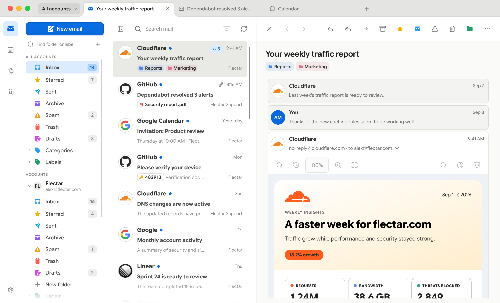
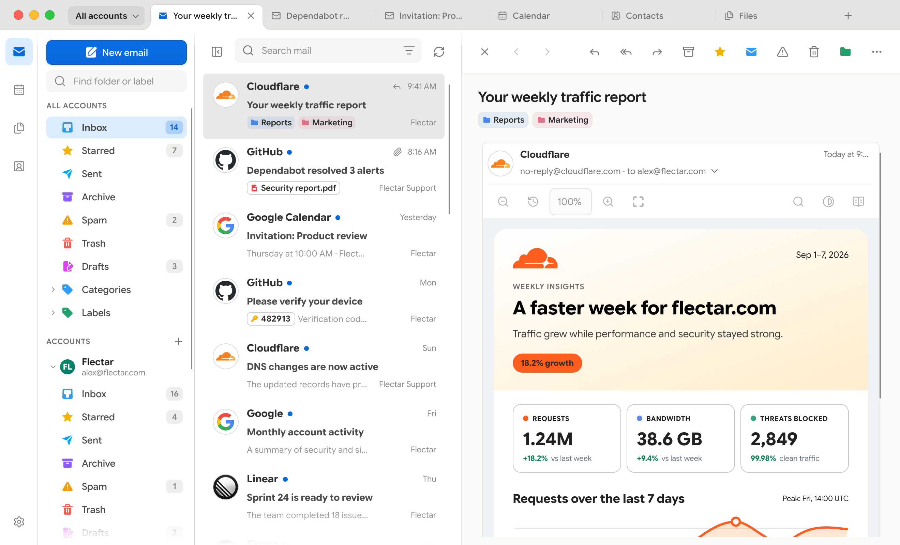
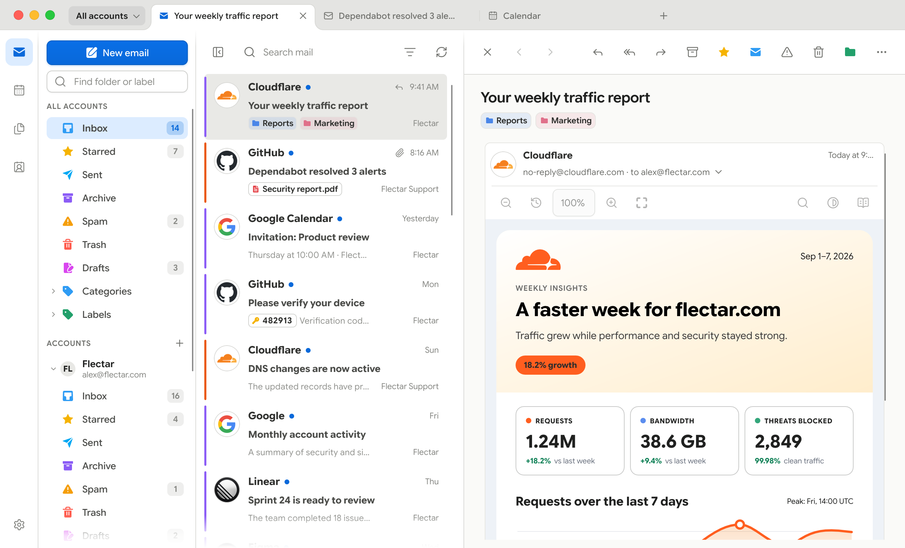
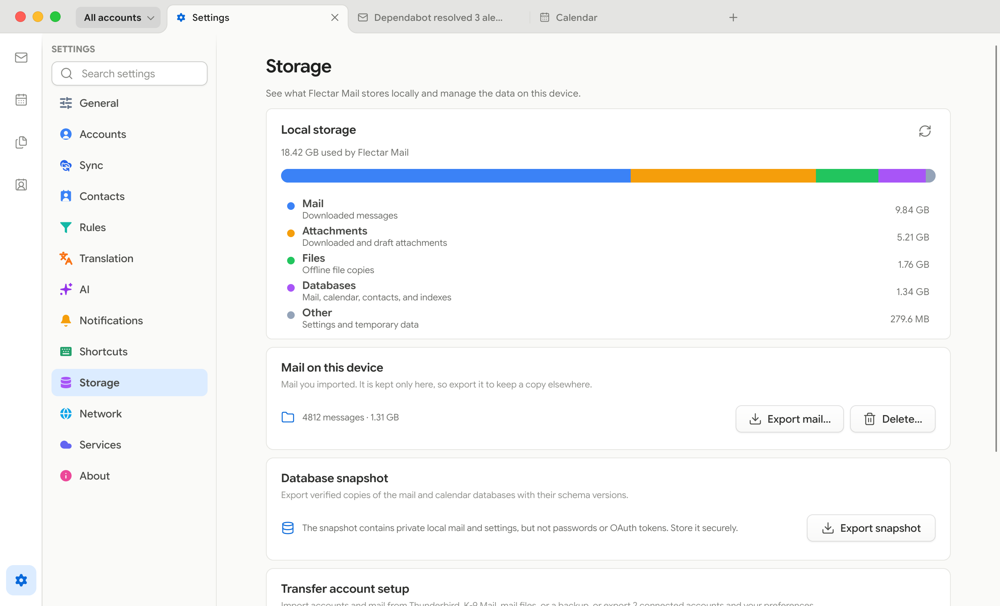

# Flectar Mail features

A closer look at what the [README](../README.md) summarizes.

- [Conversation threads](#conversation-threads)
- [Tabs](#tabs)
- [Search](#search)
- [Checking for mail](#checking-for-mail)
- [Server settings for new accounts](#server-settings-for-new-accounts)
- [Advanced account settings](#advanced-account-settings)
- [Special folders](#special-folders)
- [Sender addresses](#sender-addresses)
- [Automatic Cc and Bcc](#automatic-cc-and-bcc)
- [New-mail notifications](#new-mail-notifications)
- [Profiles and account colors](#profiles-and-account-colors)
- [Appearance](#appearance)
- [Frameless window](#frameless-window)
- [Calendar, contacts, and files](#calendar-contacts-and-files)
- [Signatures and OpenPGP](#signatures-and-openpgp)
- [Automatic replies](#automatic-replies)
- [Text formatting](#text-formatting)
- [Spell check](#spell-check)
- [Undo](#undo)
- [Before sending](#before-sending)
- [Undo send](#undo-send)
- [Snooze](#snooze)
- [Send later](#send-later)
- [Reply reminders](#reply-reminders)
- [Unsubscribing](#unsubscribing)
- [Blocking senders](#blocking-senders)
- [Rules](#rules)
- [Importance](#importance)
- [Read receipts](#read-receipts)
- [Calendar invitations](#calendar-invitations)
- [Translation](#translation)
- [AI](#ai)
- [AI agents](#ai-agents)
- [Flectar Mail Sync](#flectar-mail-sync)
- [Storage and backups](#storage-and-backups)
- [Network and proxies](#network-and-proxies)
- [Importing accounts and mail](#importing-accounts-and-mail)
- [HTML rendering](#html-rendering)
- [Smaller screens](#smaller-screens)

## Conversation threads

Replies stay grouped in chronological order, with the active message expanded
inside the reading pane. To list, open and act on every message on its own, turn
off **Conversation view** in Settings → General.

Opening an unread message marks it read. **Mark messages as read** in Settings →
General can wait 2 or 5 seconds instead, so messages you only pass over, such
as with the arrow keys, stay unread. **Never** leaves marking to you.

To mark everything in a mailbox read, right-click it in the sidebar, or press
and hold it on a phone, and choose **Mark all as read…**. In an Inbox, a folder
or a Gmail label this happens on the server too, including older mail this
device doesn't keep, up to the last check, so mail that arrives after that stays
unread. In a split inbox half, Starred or a category it marks the messages this
device shows. It can't be undone, so it asks first.

| Keys | Action |
| --- | --- |
| **Up/Down** | Move between messages |
| **Home/End** | Jump to the first or last loaded message |
| **Page Up/Page Down** | Move a page at a time |
| **Enter** | Open the current message and focus its content |
| **Space** | Check or uncheck the message for bulk actions |
| **Tab/Shift+Tab** | Move between controls |
| **F6** | In the full workspace, move focus between the message list and reader |

In the minimal layout, arrow keys highlight messages and **Enter** opens them;
**Escape** or **F6** returns to the list.

Lists start with the newest mail. To read a mailbox from its oldest mail
instead, choose **Oldest first** from the filter button next to the search
field. Each mailbox, folder and label keeps the order you chose for it, and
search results stay newest first. A notification about new mail opens such a
list at that message when it is far down, with **Show earlier mail** above it.

<picture>
  <source media="(prefers-color-scheme: dark)" srcset="../resources/screenshots/desktop-thread-dark.png">
  <source media="(prefers-color-scheme: light)" srcset="../resources/screenshots/desktop-thread-light.png">
  
</picture>

## Tabs

Keep several places open at once with browser-style tabs. Each tab remembers
its own place: a mailbox, search, or open conversation, the calendar,
contacts, files, or Settings, along with how far you scrolled the list and the
message you were reading. Pick up where you left off the next time you open
Flectar Mail.

| Action | How |
| --- | --- |
| Open a message in a background tab | Middle-click or Ctrl/⌘-click it, or choose **Open in new tab** from its menu |
| Open it and switch to it | Add Shift to the click |
| New tab | **Ctrl/⌘+T** |
| Close the current tab | **Ctrl/⌘+W**, or middle-click the tab |
| Reopen the last closed tab | **Ctrl/⌘+Shift+T** |
| Cycle through tabs | **Ctrl+Tab** and **Ctrl+Shift+Tab** |
| Jump to a tab | **Ctrl/⌘+1–8**; **Ctrl/⌘+9** jumps to the last |
| Reorder tabs | Drag them |
| Close other tabs, or those to the right | Right-click a tab |

On phones and in narrow windows, the button at the end of the toolbar shows
how many tabs are open and lays them out as cards. Tap a card to switch to it,
tap × or swipe it aside to close it, and use **+** for a new tab. Select
messages and choose **Open in new tabs** from the selection menu to open them
in the background. If you'd rather work without tabs, turn off **Tabs** in
Settings → General.

<picture>
  <source media="(prefers-color-scheme: dark)" srcset="../resources/screenshots/desktop-tabs-dark.png">
  <source media="(prefers-color-scheme: light)" srcset="../resources/screenshots/desktop-tabs-light.png">
  
</picture>

## Search

The search field finds mail stored on this device. Every word has to match,
in the subject, the sender and recipients, or the text, and a word also finds
the longer words it starts. Put words in quotes to find them as a phrase. When
nothing has every word, the list shows mail with any of them.

Operators narrow a search, as in Gmail:

- `from:` and `to:` match a name or address, and `subject:` and `body:` a word
  in that part.
- `is:unread`, `is:starred` and `has:attachment` keep those messages, and
  `filename:pdf` messages with an attachment whose name has that text.
- `in:inbox`, `in:sent`, `in:drafts`, `in:archive`, `in:spam` and `in:trash`
  search one kind of folder. Trash and Spam are left out unless a search names
  them, and `in:anywhere` takes them in too.
- `after:2026/01/31` and `before:2026/02/28` keep mail received from the start
  of that day, or before it, in your time zone. `newer_than:7d` and
  `older_than:1y` count back from now in days (`d`), months (`m`) or years
  (`y`).
- `larger:5M` and `smaller:100K` keep mail of at least, or under, that many
  bytes, with `K`, `M` and `G` for thousands, millions and billions.

`OR` in capitals finds either part, as in `from:ana OR from:ben`, and binds
tighter than the space between parts, so `invoice OR receipt 2026` finds either
word in mail that has 2026. Parentheses group parts, and a dash before a word,
a phrase, an operator or a group leaves out what it matches, as in
`-from:billing` or `-(draft OR old)`. **Search tips** in the menu beside the
search field lists them.

At the end of the results, **Search on server** asks the servers of the
accounts in view for mail this device doesn't have: mail older than it keeps,
or in folders it doesn't download. Each account's server brings up to 25 such
messages, newest first, with any of its matches here that it passed on the
way, and **Search further** brings the next. The messages come as their
headers, and a message's text when it's opened. The list then shows them with
the results here, in date order, until Flectar Mail quits. IMAP, JMAP and
Gmail accounts can be searched this way, but not POP3 accounts or mail kept
only on this device. IMAP servers can't look for attachments or file names,
so with `has:attachment` or `filename:` their results also have mail without
them.

**Save search…** in the menu beside the search field keeps the search in the
sidebar, under **Saved searches**, with a name. Its row counts the unread mail
it finds on this device. Opening it runs the search again in the accounts in
view, so new mail that matches shows up in it, and its list works like any
other search. Right-click a saved search, or hold a finger on it on a phone, to
edit its name or what it searches for, move it up or down, or delete it.
Deleting a saved search leaves its mail where it is. With mail profiles, a saved
search can show in one profile or in all of them.

## Checking for mail

Flectar Mail checks every account for new mail on its own: as soon as the
server announces new mail, where it can, and otherwise every 5 minutes, or as
often as **Check for new mail** in Settings → General says. To check now, press
F5 for the accounts the mail view shows, or Shift+F5 or the refresh button
beside the search field for every account. On a phone, pull the mail list down
from its top to check the accounts it shows. An account's menu in the sidebar
(right-click, or hold a finger on it on a phone) checks just that account.

While a check runs for more than a moment, a small spinner turns beside the
account's name in the sidebar; it holds still while motion is reduced. When the
server doesn't accept an account's sign-in, or its checks keep failing for a
minute, a red marker takes its place. Click or tap the marker to see why, with
**Try again** to check right away, or **Sign in again** when the sign-in needs
renewing. After a check you asked for, the marker shows at once. Flectar Mail
keeps trying a failing account on its own, and the marker goes away with the
next check that works. When the sidebar is hidden, as on a phone, a red dot on
the folders button says an account has a problem.

The account's menu also tells when it last checked mail, and so does its card in
Settings → Accounts, together with the account's state and the server's own
words about a failure. A card opens to the account's settings with a click, and
closes the one open before. **Account settings** in the account's menu in the
sidebar opens Settings on that card.

Each account can check at its own pace. In its card in Settings → Accounts,
**Check for new mail** keeps the interval from Settings → General, or checks
every minute, 5, 15 or 30 minutes, or every hour, or only when the app starts
and when you ask. **Instant updates** lets an IMAP or JMAP server tell Flectar
Mail of new mail as soon as it arrives. Turned off, the account checks at its
interval, which saves battery and data, and helps with a server that drops
waiting connections. An account that checks only when you ask doesn't wait for
updates either. **Server timeout** sets how long an IMAP, POP3 or JMAP account
waits for a slow server, or a slow connection to it, before it gives up. Every
wait grows alike, from connecting and signing in to downloading attachments,
and a change takes effect at once.

An IMAP or JMAP account downloads its messages in the background, as far back
as its **Mail history** goes, so they open at once and without a connection.
**Download** in the account's card changes what comes ahead of time.
**Headers only** leaves each message on the server until you open it,
**Messages** is where every account starts, and **Messages and attachments**
also downloads attachments up to 25 MB, one at a time, so they open offline
too. Larger ones download when you open them, and each device keeps its own
choice.

A server can ask Flectar Mail to slow down, when an account has too many
connections open or makes too many requests, or while another app is using a
POP3 mailbox. Flectar Mail then waits before it asks that server again, for as
long as the server said, or else for a minute that grows while the server keeps
asking, up to an hour, and a little longer or shorter for each account so they
don't all return at once. The account shows **Waiting for the server** with the
time it checks again, and a marker beside its name explains why. **Try now**
checks at once, unless the server named its wait, as Gmail and Exchange often
do. Asking again early would only make that wait longer. Changes you make
meanwhile wait too and go to the server once it's ready. When an IMAP server
turns down a connection for having too many open, Flectar Mail opens one fewer
for downloading in the background from then on. When many accounts start
together, they take turns connecting, and a few at a time download their older
mail.

## Server settings for new accounts

When you type the address of a new IMAP, POP3 or JMAP account, Flectar Mail
looks up its servers. It asks the address's domain for its own configuration
file, over HTTPS first and then over plain HTTP, and otherwise looks the domain
up in the public provider database at autoconfig.thunderbird.net. When neither
knows the domain, it asks your device's DNS which server takes the domain's
mail, and looks up the provider of that server the same way. That step is
skipped while a proxy is set, because DNS questions can't go through one. Only
the domain is sent, never the whole address. Servers it finds fill in the form
as long as you haven't changed them, and the form says where they came from.
Settings that came over plain HTTP or through DNS could have been changed on
the way, so **Connect account** waits until you check the server names and tick
**I checked these servers and trust them**. Your other accounts on the same domain, and
Gmail's servers for a Gmail address, fill in the form without a lookup.

## Advanced account settings

When you add or edit an IMAP or POP3 account, **Advanced settings** at the end
of the form holds what few accounts need. It opens on its own for an account
that uses any of it.

Turning off **Send mail** sets up an account that only receives mail, with no
SMTP server. It isn't offered as a sender, replies to its mail start from an
account that sends, and it's never asked for read receipts. Its answers to
invitations stay in its calendar without a reply by mail, it can't invite
anyone, and it leaves a mailing list only through the list's web page.

**IMAP sign-in**, **POP3 sign-in** and **SMTP sign-in** choose how Flectar Mail
signs in to each server. **Automatic** uses SASL PLAIN where the server offers
it and the plain login command otherwise, or when PLAIN fails. **PLAIN** and
**LOGIN** (**USER/PASS** for POP3) use only that way, for a server that offers
one it can't handle. Over an unencrypted connection, a password goes out only
in a way the server offers. **No sign-in** sends through an SMTP server that
takes mail from its own network without one.

An SMTP server that signs in with another username, such as your provider's or
company's relay, takes it in **SMTP username**, with its own **SMTP password**,
which stays in the system keyring like the account's. Without one, the SMTP
server signs in with the account's password.

## Special folders

An IMAP account keeps sent mail, drafts, deleted mail, spam and archived mail
in the folders its server marks for each (RFC 6154), or else in the ones named
for them, such as Sent or Trash. Where those aren't the right ones, as on a
server that marks none or names them in another language, **Special folders**
in the account's card in Settings → Accounts chooses others. **Sent**,
**Drafts**, **Trash**, **Spam** and **Archive** each go to the folder chosen
for them. The first choice, **Automatic**, keeps the server's folder, and reads
**No folder** where the server has none. A folder holds one of them at a time,
so choosing it for another frees it from the first.

From then on, sent mail and drafts are saved in the chosen folders, and **Move
to spam**, deleting and archiving move mail into them. The sidebar shows them
under the names of what they hold. A chosen folder renamed in Flectar Mail keeps
its place, one deleted gives it back to the server's folder, and with
**Subscribed folders only** a chosen folder is listed though you haven't
subscribed to it. Flectar Mail Sync takes the choices to your other devices.

## Sender addresses

An account can send from more addresses than the one it signs in with. Gmail's
send-as addresses and a JMAP server's identities come from the provider, and for
other servers you add the aliases they let you send from in the account's
**Signatures** tab in Settings → Accounts, which also chooses the one new
messages start from. An account keeps up to 1,000. Past ten, the composer's
**From** and **Default sender identity** open a picker that finds an address by
its name or address as you type, and Settings lists 50 at a time with a search
for the others.

## Automatic Cc and Bcc

Every message you write from an account can start with copies to the same
addresses, such as a colleague in Cc or your archive in Bcc. Set them under
**Automatic Cc and Bcc** in the account's **Signatures** tab in Settings →
Accounts. **Edit** on a sender address adds copies of its own, and an address a
JMAP server gives also gets the Bcc the server keeps for it (RFC 8621).

New messages, replies, replies to all and forwards start with the copies, in Cc
and Bcc, where you see them and can take them out before sending. An address the
message already goes to isn't added again. Choosing another sender swaps the
copies for that sender's and keeps the addresses you typed, while a draft you
open again keeps the ones it had. Read receipts, answers to invitations and
other mail Flectar Mail sends for you get none. Flectar Mail Sync takes the
copies to your other devices.

## New-mail notifications

Flectar Mail lets you know when new mail reaches your Inbox while it's running,
and on Android and iOS when it checks in the background: one notification per
message, with its sender and subject. When more than three messages reach one
account at once, a single notification sums them up. Choose which mail notifies
with **Desktop notifications** in Settings → Notifications (**New mail
notifications** on Android and iOS): **Important mail**, the default, leaves out
newsletters and other automated mail, **All new mail** includes it, and **Off**
turns notifications off. On a computer, mail that came in while Flectar Mail
wasn't running waits quietly in the Inbox, and mail that reaches the inbox
you're looking at simply appears in the list.

Click a notification to open its conversation, or use its buttons to mark the
message as read or move it to the archive, or to the trash for accounts without
an archive, without opening the window. A notification goes away by itself once
its message is read, leaves the Inbox, is snoozed, or is deleted, here or on
another device. Only mail from people plays a sound, once per batch; turn it off
with **Notification sounds** in Settings → Notifications. To keep getting
notifications with the window closed, turn on **Keep running in system tray** in
Settings → General, or **Keep running in the background** in the Flatpak.

macOS asks for permission the first time Flectar Mail has a notification to
show. If notifications are turned off for Flectar Mail in the system's settings,
Settings → Notifications says so, and on Windows and macOS its **Open system
settings** button goes straight there. On Linux, the desktop's notification
server shows them, or the notification portal in the Flatpak, where the desktop
also decides whether they play a sound.

On Android, Flectar Mail asks for permission once an account is set up, as
Android 13 and later want apps to. It checks for new mail about every 15
minutes in the background, which also tells you about mail that came in while
the app was closed, and less often while the phone is idle. Android pauses the
checks while Battery Saver is on or while Flectar Mail is restricted in the
background, which Settings → Notifications says, with a way to its settings.
Mail that may play the sound arrives in the **New mail** channel and the rest in
**New mail without sound**, which you can each change in Android's settings.

On iOS, Flectar Mail asks for permission once an account is set up. It checks
for new mail in the background when iOS lets it, which also tells you about mail
that came in while the app was closed. iOS decides how often from how you use
the app, so a notification can come well after its mail. It doesn't check while
Low Power Mode is on or Background App Refresh is off for Flectar Mail, and it
may not until you open the app again after closing it in the app switcher.
Settings → Notifications says when iOS isn't checking. Archiving or deleting
from a notification asks you to unlock the device first.

The app icon shows how many unread messages are in the Inbox, counting the
same mail as notifications: Important mail, or every message with **All new
mail**. The number stays until the mail is read, here or on another device;
turn it off with **Unread count on the app icon** in Settings → Notifications.
macOS shows it on the Dock and iOS on the Home Screen icon when badges are
allowed for Flectar Mail in its notification settings, Windows on the taskbar
button, and Linux on docks that show counts, such as KDE Plasma's, Ubuntu Dock
and Dash to Dock, elementary OS's and Plank. With **Keep running in system
tray** on, the tray icon shows the count too on Windows and Linux, so it stays
in sight while the window is closed. Pointing at the tray icon shows the number
as well, except in GNOME, whose top bar has no tooltips.

## Profiles and account colors

Group related accounts into named profiles such as Work or Personal, then give
each profile its own color. Create a profile from the profile menu at the start
of the tab bar, or in Settings → Accounts → Profiles, and check the accounts
that belong to it. Choose a profile in that menu to focus the mail view on its
accounts: the unified inbox, search, counts, and sidebar show only their mail,
while your tabs stay the same. **All accounts** shows everything again.

Each account can also have a name of its own, such as Office or Shop. Type it
in **Account name** under the account in Settings → Accounts. The sidebar, the
unified inbox and every list of accounts then show it instead of the address,
and it never appears on the mail you send.

You can also override an individual account's color and show the effective
color along the left edge of every message. The markers make accounts easy to
tell apart while working in the unified inbox; the example below uses purple
for Work and orange for Support.

<picture>
  <source media="(prefers-color-scheme: dark)" srcset="../resources/screenshots/desktop-profiles-dark.png">
  <source media="(prefers-color-scheme: light)" srcset="../resources/screenshots/desktop-profiles-light.png">
  
</picture>

## Appearance

Choose the workspace that fits the way you handle email. Keep the detailed
three-pane layout, switch to a streamlined minimal view, choose a light or dark
theme, select a built-in color palette or create a custom one, and show or hide
sender avatars. You can also give the app icon a different color: on the
taskbar or Dock, in the system tray, in the Linux app launcher, and on Android
and iOS home screens.

The full workspace keeps your folders, message list, and selected email visible
together. The minimal layout reduces visual noise and gives each part of your
inbox more room when you need it.

Message appearance can follow the app theme or stay light or dark independently.
It uses your selected color palette for HTML, plain text, and Reader mode.
To temporarily show the sender's original colors, use the contrast icon between
Find and Reader mode in the desktop message toolbar, or choose **Show original
colors** from the message's three-dot menu on any screen size.

A message's subject can be selected and copied like its text, and right-clicking
it offers **Copy** for the whole subject. Right-click the sender for **Copy email
address** or **Copy name and email address**, and click the sender to see whom
the message went to, where every address can be selected and copied too.

Turn on **Reduce motion** in Settings → General → Interface, or leave it on
System to follow Animation effects on Windows, Reduce motion on macOS and iOS,
the desktop's reduced motion setting on Linux, Remove animations on Android, or
animation reduction on HarmonyOS. Panels, rows and dialogs then appear at once
instead of sliding or growing, and only fades remain.

**Interface text size**, in the same place, makes the text in menus, lists and
settings smaller or larger, from 90% to 150% of your device's text size. Message
zoom and the text size of new messages stay separate.

**Message list density**, also there, makes the list's rows **Compact** to fit
more messages on the screen, and **Message preview** shows up to three lines of
each message's text below its subject. With **None**, a row is the sender and
the subject, with any codes, attachments and labels beside the subject and the
account beside the time.

## Frameless window

Flectar Mail replaces the system title bar with window controls in the toolbar
by default; turn off **Frameless window** in Settings → General → Interface to
bring the system title bar back. Each platform keeps its own behavior: macOS
keeps the native traffic lights, Windows keeps Snap Layouts and the system menu,
and Linux follows the button order and title-bar actions configured for GNOME or
KDE.

## Calendar, contacts, and files

Mail, calendars, and contacts sit side by side, synced over Google, Microsoft,
CalDAV, and CardDAV. Mailbox and calendar data are stored locally, so synced
data stays useful without a connection. The Files view browses JMAP and WebDAV
storage, searches mail attachments, keeps files offline, and previews PDFs,
images and text. [Contacts and CardDAV](carddav-contacts.md) describes how
contacts are stored and synced. To sync an account's contacts with a CardDAV
server, open its card in Settings → Accounts and choose **Connect** under
Contacts.

To bring contacts from another address book, a phone or Google Contacts,
export them there as a vCard file and choose **Import contacts…** in the menu
next to the contacts search. Flectar Mail reads vCard 2.1, 3.0 and 4.0 files,
tells how many contacts are new and how many you already have, and lets you
leave the ones you have as they are, add what's new to them, or import them
again as copies. With an account's contacts open, new contacts go to its
address book. **Export contacts…** saves every contact to one vCard file.

## Signatures and OpenPGP

Settings → Accounts → Signatures & OpenPGP provides named signatures, separate
new-message and reply defaults, and a composer signature selector. Desktop
OpenPGP/MIME signing and encryption use installed GnuPG 2.x with pinentry for
private-key passphrases. Required encryption blocks delivery when recipient keys
are missing or invalid; protected drafts remain local until Send.

Signatures are written in the composer, with the formatting, links and
pictures a message can have. **Edit signature** and **New signature** open it
in a window of its own on the desktop, and in place of Settings on phones,
with the signature's name where a message has its subject. A signature goes
into a message under a `-- ` line, its pictures as parts of the message, and
its plain text takes the message's own font and size. It holds pictures of
its own, never ones from the web, and up to 256 KB in all.

S/MIME and mobile OpenPGP are not currently supported.

## Automatic replies

Settings → Accounts → Automatic replies sets the replies a Gmail or Microsoft
account's server sends while you're away: a message, an optional first and
last day, and whether only your contacts or, in a work account, only your
organization get one. Gmail replies have a subject of their own, and Gmail
answers each sender once, and again after four days, never answering mailing
lists or spam. Outlook answers each sender once while replies are on, and
replies that start on a first day need a last day too. The first save asks
Google or Microsoft to let Flectar Mail change those settings, and signing in
again keeps that.

The replies are kept on the server, so they go out while Flectar Mail is
closed. Syncing reads them back, so replies set on the web show too, and a
strip over the mail list says when they're on, with Turn off.

JMAP accounts whose server offers automatic replies, such as Fastmail, set
them the same way, with a subject and days, for every sender.

IMAP accounts whose server runs mail filters through ManageSieve, as Dovecot,
Cyrus and Stalwart servers can, set them the same way, with a subject and
days, for every sender, and so do JMAP accounts on servers that run mail
filters, such as Stalwart and Cyrus. The server answers each sender once, and
again after four days, and skips mailing lists, newsletters and spam. Flectar
Mail keeps the replies in a filter script of its own, named flectar-mail,
which other devices read back, and never edits your own filter scripts. When
the server already runs one, Flectar Mail asks first, then sends the replies
and runs your script after them, unchanged, and turning replies off leaves
your script running alone again. It won't combine them with a script that
sends replies of its own. Other IMAP accounts and POP3 accounts get automatic
replies from their provider's webmail.

## Text formatting

The composer's toolbar sets the font, size and color of text, a highlight
behind it, and how each paragraph lines up, next to bold, italic, underline,
strikethrough, lists, quotes, inline code and links. The font is **Default**,
which names none so that each reader sees their own, as with plain text, or
serif or fixed width. Sizes are small, normal, large or huge. Text color and
highlight each offer 64 colors, and **Automatic** or **No highlight** takes a
color off. New messages, replies and forwards start in the font and size set in
Settings → General, under Writing. **Remove formatting** returns the selection
to that style and keeps its links and alignment. From the keyboard,
Ctrl+Shift+L, Ctrl+Shift+E and Ctrl+Shift+R align paragraphs left, center and
right, and Ctrl+\\ removes formatting (Command instead of Ctrl on a Mac).

Text pasted from web pages, documents and other messages keeps the formatting
the composer has: bold and the other marks, links, lists, quotes, headings,
colors and highlights. Its usual font, size and color give way to the message's,
as do backgrounds that only belonged to the page. Copying and pasting within a
message keeps its formatting exactly. Ctrl+Shift+V (Command-Shift-V on a Mac),
or **Paste as plain text** in the editor menu, pastes the text alone, in the
style of the text around it. On phones, text pastes as plain text.

**Insert image** in the toolbar puts pictures in the text at the cursor, and
pasting a screenshot or a picture copied from another app does the same on the
desktop. Files dropped on a message go in too, pictures in the text and other
files as attachments. Dropped on the window with no message open, they start a
new one. The Flatpak gets dropped files through the desktop's file portal,
which GNOME Files and Dolphin use under Wayland. Files from other apps, or
under X11, go in with **Attach files** instead. PNG, JPEG, GIF
and WebP images show at their own size, or smaller to fit the window, and a
click selects one. They go out as parts of the message that mail apps show in
place, and mail read as plain text names each one. A forward keeps the
original's images, and a message edited as new keeps its images and
formatting, also when another app wrote it. Images and attachments can take up
to 25 MB in all, the size most mail servers accept.

A selected image gets a bar of its own. **Size** makes it small, medium or large,
or its own size again, and only changes how wide it shows, so the file goes
out as it is. **Alt text** gives the words screen readers read in its place,
and left empty it marks the image as decoration. Right-clicking an image
offers both in the editor menu. On the desktop, dragging a corner of a
selected image sizes it too, up to its own width.

When a message holds JPEG photos larger than 1600 pixels across or down, in
the text or attached, a **Shrink photos** switch shows above the message's
buttons with their number and size. Turned on, each goes out at 1600 pixels
on its longest side, and the row shows the size they come to. Photos stay
upright and keep their colors, and leave out the other details cameras save
in them, such as where they were taken. Photos added while it's on go in
shrunk, so more fit in a message's 25 MB. The message shows the same as
before, and turning the switch off brings back the photos at full size while
the message is open. It starts off for each message, and other images, such
as screenshots and animations, go out as they are.

Messages carry the formatting in HTML that mail apps widely support. Sizes
scale with the reader's own text size, and each font names common
alternatives in case the reader lacks it. In a dark theme, the composer shows
dark text colors lighter so they stay readable, and the message keeps the
colors you chose. Mail apps that read only plain text get each link's address
after its text, and each picture's name in its place.

**Plain text** in the toolbar sends a message as plain text only, with no
formatting or HTML. Switching takes the message's formatting and pictures out
and writes each link's address after its text, and Undo brings them back. A
plain-text message shows the original it answers as the quoted text that goes
out, its signature goes in as text, and pictures dropped on it are attached.
**Formatted text** switches back. Each account chooses how its messages start
in Settings → Accounts, under its sender identities and signatures, and replies
and forwards to plain-text messages start as plain text unless that's turned
off there. A draft opens again as it was saved.

**Forward as attachment**, in a message's **More** menu or in the **More** menu
for messages chosen in the list, attaches them to a new message, each as it
arrived, which mail apps open as a message. A conversation chosen in the list
sends each of its messages. They join the new message once they're fetched,
from this device or from the server, and a copy of mail sent from here leaves
out who it was blind copied to. A forward waits for its files, these and the
original's attachments, before it can be sent.

A message that carries another message inside it, as some mail apps forward
one and as a bounce returns one, shows that message below its own text, under
the sender, date, subject and recipients it had. One sent as an attachment
stays a file. Either way it's listed with the files as an `.eml` file named
after its subject, and so are the files it carries.

**Email templates** keep a subject and message to start from, which the
composer's template list inserts at the cursor. **Insert placeholder** in a
template's editor adds placeholders, such as `{{recipient.first_name}}`,
`{{sender.name}}` or `{{date}}`, that the template fills in as it's inserted,
from the first person in To, by the name the message shows or their
contact's, from the address the message is sent from, and with today's date.
`{{recipient.first_name | 'there'}}` names what to put when the name isn't
known. A placeholder the message can't fill, or one of your own such as
`{{company}}`, stays for you to fill in, and sending a message that still has
one asks once to send it as it is.

**Large files** go by link. In Settings → General, turn on a Gmail account's
Google Drive or a Microsoft account's OneDrive, which asks the account to let
the app reach the files it makes there, or connect a Nextcloud or ownCloud
server, signed in to in the browser or with an app password. A Google app of
your own needs the Google Drive API turned on in its Cloud project first. A
message uses its account's Google Drive or OneDrive when that's on, and the
server otherwise. Files too large for a message go up as they're added, as do
files shared with **Share files by link** beside **Attach files**, into a Mail
attachments folder, and the message carries a block listing them with their
sizes and until when their links work, 30 days unless that's changed, or less
where the server limits links. Google Drive links, and OneDrive ones without
Microsoft 365, last until the file is deleted. A Nextcloud or ownCloud link can
ask for a password, which the message leaves out for you to pass on another
way. Sending waits for the uploads, removing a file before sending takes its
upload back, and a draft keeps its links.

## Spell check

Flectar Mail underlines misspelled words as you write. On Windows, macOS, iOS
and Android it uses the system's own spell checker, and on Linux the Hunspell
dictionaries installed on your system, the ones other apps there use too.
Right-click an underlined word for corrections, **Add to dictionary**, or
**Ignore**, which accepts it in that message. With the keyboard, the menu key
or Shift+F10 opens the same menu for the word at the cursor. The menu also
cuts, copies and pastes, and its **Spelling** submenu turns checking on and
off. On a phone, or any touch screen, tap an underlined word for the same
corrections, without the editing commands. A word you're still typing is
underlined once you move past it, and quoted text, code and the signature the
composer added aren't checked. Turn spell checking off with **Check spelling**
in Settings → General, which also says when there's nothing to check with.

On Windows and Linux, the **Spelling** submenu also chooses your languages.
Flectar Mail starts with the display language you chose in Settings, if any,
and the languages your system is set to, and a word passes when any of the
chosen languages has it, so mail in two languages needs no switching. On iOS it
checks in the same display language and your preferred languages, from Settings
under General, Language & Region, the same way. On macOS, the system picks the
language of what you write from the ones set in System Settings, under
Keyboard, Text Input. On Android, the spell checker chosen in Android's
settings checks, usually the keyboard's, in the language set there.

Words you add go where the system keeps them, so other apps share them. On
Windows that's the list in Windows Settings, and on macOS the dictionary
**Learn Spelling** adds to. On Linux it's the lists GNOME apps use, in
`~/.config/enchant/<language>.dic`, and the Flatpak keeps its own. On iOS the
system learns the word. On Android, **Add to dictionary** opens Android's own
dialog for the personal dictionary, as its text fields do. Windows checks the
languages added in Windows Settings, under Time & language. On Linux, most
distributions package dictionaries as `hunspell-` and the language. In the
Flatpak, English comes with the runtime, and other languages come with the
translations Flatpak installs for the languages your system uses.

Checking keeps no dictionary in memory, and nothing is set up until you write.
Windows and macOS check in a system process, and Android in the spell
checker's own process, usually the keyboard's. On Linux, the first time a
dictionary is used, a short-lived Flectar Mail process indexes its words into
the app's cache, and each check reads them from that file and lets go when it's
done. Closing the last message lets go of the rest, except where the system
keeps its spell checker in each app that has used it: on macOS about 0.4 MiB,
and on iOS, which checks in the app, about 3 MiB for English and 4 MiB with
Spanish too in the iOS Simulator, until the app quits.

## Undo

After you archive, delete, move or mark mail as spam, mark it as read or unread,
or star it, a notice at the bottom of the window says what changed, with
**Undo**. Undo, or Ctrl+Z (Command-Z on a Mac) while the notice shows, puts the
mail back as it was, also when the change already reached the server. Permanent
deletion, labels, and moving or copying mail to another account can't be undone.

## Before sending

**Send** asks first when a message has no subject, with **Send without
subject** and **Add a subject**. It also asks when a message mentions a file,
with a word such as attached or enclosed or a file name such as report.pdf, but
has none attached. **Attach files…** then opens the file picker, and **Send
anyway** sends the message as it is. Only what you wrote counts, so quoted
text, your signature and links don't. Each language has its own words, and the
English ones always count.

## Undo send

When you send a message, its composer closes and the message waits ten seconds
before it leaves, while a notice at the bottom of the window says **Sending
message…** with **Undo**. Undo, or Ctrl+Z (Command-Z on a Mac) while the notice
shows, takes the message back and opens it again as the draft it was,
attachments included. Choose 5, 10, 20 or 30 seconds, or turn the delay off,
with **Undo send** in Settings → General. With it off, the composer stays open
until the message is sent, and keeps it to fix if sending fails.

If a message can't be sent, the notice says why, the message stays in Drafts,
and **Open draft** brings it back to fix and send again. Quitting Flectar Mail
during the delay sends the waiting messages right away rather than at the next
start.

## Snooze

Snooze takes a conversation out of the Inbox until a time you choose, then
brings it back to the top. Choose **Snooze…** in a message's menu or the mail
list's, also for several checked conversations at once, and pick **Later
today** (in the evening, offered until 5 PM), **Tomorrow** or **Next week**
(in the morning), **This weekend** (Saturday morning), or a date and time of
your own. Snoozed conversations wait in **Snoozed** in the sidebar, each with
the time it comes back, and **Unsnooze** there brings one back at once.

## Send later

The clock beside **Send** in the composer schedules the message for
**Tomorrow morning**, **Tomorrow afternoon**, **Monday morning**, or a date and
time of your own. Scheduled messages wait in **Scheduled** in the sidebar.
Open one to send it now, pick another time, or **Cancel send**, which makes it
a draft again.

The device you scheduled a message on sends it at its time, as long as
Flectar Mail runs there. With **Keep running in system tray** (**Keep running
in the background** where there is no tray) in Settings → General, closing
the window keeps it running. If Flectar Mail isn't running at the time, the
message goes out as soon as it starts again. A JMAP server that holds
scheduled mail itself, in a Scheduled mailbox, sends the message even with
all your devices off.

With [Flectar Mail Sync](#flectar-mail-sync), scheduled messages show on all
your devices, and any of them that is running sends a message when the device
that scheduled it is off, whatever kind of account it is from. A message goes
out once however many devices you have: a device sends only in its turn, and
one that takes over a send another device may have started first makes sure
it didn't go out already. When a mail server never confirms that it took a
message, Flectar Mail doesn't send it again by itself, and the message shows
**May have gone out. Check Sent first.** Look in Sent, then send it again or
cancel it.

## Reply reminders

**Remind me if no reply**, the bell in the composer, picks a time:
**Tomorrow**, **In 3 days**, **In a week**, or your own. If nobody has replied
by then, the conversation comes back to the top of the Inbox, marked **No
reply yet**.

## Unsubscribing

Mail from a mailing list shows **This message is from a mailing list.** with
**Unsubscribe** above the message, and its menu has **Unsubscribe…**. Flectar
Mail asks first and says how the list takes the request.

- If the sender signed a one-click request (RFC 8058), Flectar Mail sends it to
  the list's website itself. It does so only when your mail server reports a
  passing DKIM signature that covers the request, as the standard requires.
- Otherwise, if the list takes requests by email, Flectar Mail sends one from
  the address the list writes to, and it appears in Sent. **Review email**
  opens it as a new message to look over before sending.
- Otherwise the list's unsubscribe page opens in your browser.

Once the request is made, if more of the list's mail is in the inbox, Flectar
Mail offers to archive it or move it to the trash, with Undo. A list is known by
its List-Id, or by its sender when it has none. Mail in Spam never offers to
unsubscribe, since answering spam tells its sender that the address is read.

## Blocking senders

**Block sender…** in a message's menu asks first, then sends that address's
mail to Spam in every account. What is in an inbox now moves there, with Undo,
and Flectar Mail moves their new mail there as it receives it, without a
notification. The list is kept in Flectar Mail, not by your mail provider, so
other apps can show their new mail in the inbox until Flectar Mail checks for
mail. Flectar Mail Sync keeps the list the same on all your devices.

**Unblock sender** in the same menu, or **Unblock** in Settings → Contacts →
Blocked senders, stops it. Mail already in Spam stays there.

## Rules

Rules sort new mail as it arrives in an Inbox. Make them in Settings → Rules,
where Flectar Mail tries them from the top. A rule looks at the sender, the
recipients, the subject, the mailing list, the size, any header such as
X-Spam-Flag, the body or the attachments, and needs all or any of its
conditions. Text is compared without regard to case, and a condition can also
match a regular expression. The rule then moves, labels, stars, archives,
trashes or junks the mail, marks it read, or shows it under Important, Other or
another category, where the conversation stays. Accounts that keep a message in
several folders, such as JMAP accounts, can copy it too. Moving mail out of the
Inbox ends the rules for it, and **Stop here** ends them after any rule.

**Run on Inbox…** in the editor runs a rule on the mail already in an Inbox. It
first says how many messages the rule matches there, and Undo takes it back.
Mail whose body isn't downloaded yet can't be checked by a rule on the body.
**Create rule…** in a message's menu starts a rule for the mailing list the
message came from, or for its sender.

Flectar Mail runs rules on this device as it receives mail and before it
notifies, so mail a rule moves away or marks read stays silent. A rule on the
body, or on attachments where the server tells of them only with the body,
fetches the message whole first and holds its notification until the rules are
done. Mail that came while the app was closed is sorted when it next checks for
mail. What it finds when it first downloads an account stays where it is.

Where an account's server runs Sieve filters, as many IMAP servers do and JMAP
servers such as Stalwart and Cyrus, Flectar Mail puts its rules there too, so
they sort mail while the app is closed. They go into a script of its own beside
the automatic replies, and filters you made elsewhere keep running after them
once you allow it. The server takes the rules from the top for as long as it
can do what each one asks just as Flectar Mail does. A rule that looks for a
pattern or for attachments stays in the app, and so do the rules after it,
since the server sorts mail first. Each rule says where it runs, and its editor
says why. Each device keeps its own rules. When the server already runs rules
another device put there, Flectar Mail leaves them until you choose to replace
them.

Below the rules, **Clean up** empties Trash and Junk of mail that has been
there for a week up to three months, as you choose. The time counts from when a
message went into the folder, not from when it arrived, and starred mail stays.
Flectar Mail deletes such mail for good while it's open. Gmail and Outlook.com
already empty both folders after 30 days on their own.

## Importance

**High importance** and **Low importance** under **More options** in the
composer mark how important a message is, and a draft keeps the choice. The
message carries it in the Importance and X-Priority headers, which Outlook,
Thunderbird and webmail read. Mail that arrives marked high importance shows a
red mark in the mail list, also for a conversation with such a message in it.

## Read receipts

Some senders ask to be notified when you read their message. Flectar Mail sends
no such read receipt unless you choose otherwise with **Read receipts** in
Settings → General. **Never send**, the default, leaves the requests
unanswered. **Ask each time** shows the request above the message, with **Send
receipt** and **Ignore**. **Always send** sends one when you open the message,
but still asks first when a request looks unusual: the receipt would go
somewhere other than where the message came from, or to several addresses, or
the receiving server couldn't confirm who sent the message. Mail in Spam,
mailing lists and other automated mail, and your drafts and sent mail never
get one.

A receipt says only that the message was shown on your screen, as the
standard puts it (RFC 8098). Sending one or ignoring the request answers it for
good, and IMAP and JMAP servers usually keep that answer, so your other devices
don't ask again.

To ask for a receipt yourself, choose **Request a read receipt** under **More
options** next to **Discard** in the composer. The message then asks to send
the receipt to the address it's from. **Request read receipts** in the
account's mail settings, under the message format, makes new messages from
that account ask by default. Recipients and their mail programs are free to
ignore the request, and many do. The copy in Sent is marked as answered where
the server keeps that, so no mail program answers your own copy.

When a receipt comes back for a message you sent, the message lists it under
**Read receipts** at its end, after any attachments, with when it was sent:
**Read by** when your message was shown, **Deleted by** when it was deleted,
read or not, and **Received by** when the recipient's mail program handled it
without showing it, such as with a rule. A long list shows the first two
receipts and a button for the rest. Deleting a receipt keeps what it said on
your message.

## Calendar invitations

A message with an invitation shows a card above it with the event's day and
time, where it takes place, who organizes it, who else is invited, and how many
guests have accepted.
It also says when the event clashes with others in your calendar. **Accept**,
**Maybe** and **Decline** answer it, and your answer stays selected, so another
click changes it. **Join** opens an online meeting, and the calendar button
opens the event in the calendar.

Your answer reaches the organizer once, from wherever the event is kept.
Microsoft and Google calendars answer through their own service, a CalDAV
server that schedules for your address tells the organizer itself, and
otherwise Flectar Mail emails a reply from the address the invitation was sent
to.

**Add invitations to my calendar** in Settings → General decides which
invitations join your calendar as they arrive: **From everyone**, **Only from
people I know** (the default), or **Only when I answer**. People you know are
those you've emailed or saved as contacts, when your mail server confirms the
message really comes from them, since a sender's address alone is easy to forge.
Any other invitation waits in its message, and answering it adds it. An event
only shared with you, rather than an invitation, has **Add to calendar**, and
invitations in imported mail wait for an answer too.

The card also shows updates, cancellations, and answers to your own
invitations. A cancelled event offers **Remove from calendar**, which takes it
out without telling anyone. An invitation that a newer version has replaced
says so and is answered from the newer one. Invitations in Spam or Trash, and
from blocked senders, stay out of your calendar, so their card has no answers.

An invitation to one occurrence of a repeating event, such as one meeting of a
weekly series moved to another day, is answered for that occurrence alone.
Invitations can also be answered from **My response** in an event's details in
the calendar, and for an occurrence of a repeating event Flectar Mail asks
whether the answer is for **This event** or **All events**.

In the calendar, an invitation waiting for your answer is outlined, and
declined or cancelled events are faded with their title struck through. An
invitation reminds you of itself only once you accept it or answer **Maybe**,
so one you haven't answered, such as calendar spam, stays quiet.

## Translation

Flectar Mail translates messages in other languages through a service you
choose in Settings → Translation. DeepL works with your own API key,
LibreTranslate with your own server or libretranslate.com, and a model with the
AI server you set up in Settings → AI. Nothing is sent anywhere until you
translate a message, or ask for a language to be translated always.

When a message is in a language you don't read, a bar above it offers to
translate it. Flectar Mail finds the language on your device, and counts the
app's language and your system's languages as the ones you read. The bar's menu
translates a language always, or never offers it again. **Translate message**
in a message's menu works on any message. The translation shows in place of
the message, links and formatting included, and **Show original** brings the
message back. Translations stay on your device for 15 days, so a message opened
again isn't sent again, and search never sees them.

In the composer, **Translate** in the toolbar translates the selected text, or
the whole message when nothing is selected, into the language you pick. A
reply starts with the language of the message it answers, and after that the
language you used last. The translation takes the place of the text as one
step that Undo takes back. With an AI server set up, Translate is in the
composer's writing tools menu instead.

With a free DeepL key, DeepL's terms let it keep the text it translates, and
don't allow personal data, which mail usually holds. With a paid key, DeepL
keeps the text only as long as it needs to translate it, and doesn't use it to
improve its services. A
LibreTranslate server or the AI server receives the text of what you
translate.

## AI

Flectar Mail can summarize conversations, suggest replies and help with what
you write, with an AI server you set up in Settings → AI. Any server with the
OpenAI chat API works, such as Ollama or LM Studio on your computer, or a hosted
one with your API key. Nothing is preset, and nothing is sent until you use one
of these features.

**Summarize conversation** in a message's menu shows a summary above the
conversation, with what to do next and a proposed reply. **Reply with this**
opens a reply with that text to edit, and **Suggest replies** offers short
replies to pick from. Select text in a message and choose **Ask AI** in its
menu to have it explained, or to run one of your own prompts on it. The answer
shows in the same place.

In the composer, the writing tools first in the toolbar proofread the selected
text, or the whole message above your signature when nothing is selected, or
run one of your prompts on it. Only the words that change are replaced, so
formatting, links and pictures stay, and Undo takes the change back in one
step. You write your prompts in Settings → AI, each a name and what it asks
for, such as Shorter with "Make it shorter, keeping what matters."

The server gets only what you use a feature on, the conversation you summarize
or the text you work on. It gets the text a message shows, not text a sender
hid in it, and messages reach it as data, marked as not being instructions.
Answers are plain text, without links or pictures, and marked as written by AI.
A summary also says when a message tries to instruct the AI, and lists links,
addresses and phone numbers it has that the messages don't, which shouldn't be
trusted. A long conversation is summarized from its newest messages, and the
summary says how many older ones it leaves out. A server on your computer or
local network gets less at a time, as local models read less at once.

## AI agents

Settings → AI agents lets an AI app on your computer, such as a desktop
assistant or a local model, read your mail through the Model Context Protocol
(MCP). This is separate from the AI features in Settings → AI, and access
stays off until you turn it on. The agent's app starts `flectar-mail mcp`, which hands each request to
Flectar Mail while it runs, so mail still syncs in one place.

Agents can list your accounts, folders and labels, list and search messages,
read messages and conversations as plain text, search contacts and list
calendar events, and nothing more unless you allow it. You choose which
accounts they can read, mail imported to this device among them, and for each
account which folders. Spam and Trash stay out until you add them, since junk
mail is where hostile instructions are most likely to hide. Encrypted messages
are withheld, and passwords, sign-in tokens and keys never reach an agent.

With Write drafts on, agents can also save plain-text drafts, new messages or
replies, in Drafts for you to check and send yourself. An agent can change its
own draft until you edit it, and never anyone else's.

Three more switches let agents mark messages read or flagged, move them to the
archive, to Trash or to another folder, and add or take off your labels. They
can change messages only in folders they can read, and never delete anything
for good. Together they can change 100 messages a minute.

With Ask to send on, an agent can ask to send a draft. It opens in a window of
its own, with a note naming the agent, and it's sent only if you send it. One
draft opens at a time, and a message you're writing stays as it is.

The page shows how to add Flectar Mail to Claude Desktop, Claude Code, VS Code,
Cursor, Zed, LM Studio and Codex, with links that add it to VS Code and LM
Studio, and the command any other app needs. Its activity log lists what each
agent did, without message content, and undoes what an agent changed for a
week after.

What a message says comes from its sender. Agents are told to treat mail as
data, and message text reaches them between markers that say so, but no agent
is immune to instructions hidden in mail, so give agents only what they need.

## Flectar Mail Sync

Flectar Mail Sync keeps your accounts and their sign-ins, preferences,
signatures, profiles, templates, blocked senders, snoozes, reply reminders
and scheduled messages the same on all your devices. Everything is end-to-end
encrypted before it leaves a device, so not even Flectar Mail can read it, and
there is no account to create: a 24-word recovery code brings sync back on a
new device. Your mail, contacts and calendars keep syncing with your mail
provider as before.

Turn it on in Settings → Sync. To add a device, choose **Add a device** on one
that already syncs and type the code it shows into **Enter code** on the new
one, either on the welcome screen or in Settings → Sync. A device can also join
with your recovery code. Each device keeps its own mail checking, how much mail
history it downloads and what it downloads ahead of time, its proxy and server
timeout, and settings that belong to the device itself, such as reduced motion
and text size.

Flectar Mail Sync is a paid service, with a free trial, that pays for the
servers it runs on. Each contribution to Flectar Mail earns a free year of it,
see [CONTRIBUTING.md](../CONTRIBUTING.md).

## Storage and backups

Settings → Storage shows how much space mail, attachments, offline files, and
databases use on the device. From the same page, you can export verified database
snapshots or transfer connected-account setup and preferences through a backup.
Passwords and OAuth tokens stay in the system keyring, so a restored device asks
you to sign in again.

POP3 accounts download mail to this device and leave it on the server unless
you choose otherwise: each account can remove mail from the server after 7, 14,
or 30 days, once you delete it here, or as soon as it's downloaded, but never
before it's stored on this device. Their folders exist only on this device, so
snapshots include that mail, and removing a POP3 account or deleting all data
offers to export it first as mbox files, one per folder, which other mail apps
can import.

<picture>
  <source media="(prefers-color-scheme: dark)" srcset="../resources/screenshots/desktop-storage-dark.png">
  <source media="(prefers-color-scheme: light)" srcset="../resources/screenshots/desktop-storage-light.png">
  
</picture>

## Network and proxies

Settings → Network chooses how Flectar Mail reaches its servers. By default it
follows the system's proxy settings. Mail servers then go through the system's
SOCKS proxy, if one is set, and everything else through the system's web
proxy. Web proxies often refuse connections to mail servers, so mail goes
through one only when you enter it yourself.

The system's settings are Internet Options on Windows, the network settings on
macOS and iOS, the desktop's own settings on Linux (GNOME's, KDE's and others,
read through the desktop portal) and the Wi-Fi settings on Android, with
automatic proxy configuration scripts too. Proxy environment variables such as
`https_proxy` and `ALL_PROXY` come first when they're set, so a program started
with a proxy of its own keeps it.

You can also turn proxies off, or enter one by hand. A SOCKS5 proxy also looks
up the servers' names, so the network you're on doesn't see them. An HTTP
proxy carries every connection through CONNECT tunnels. A proxy's password
stays in the system keyring. Names and addresses you list skip the proxy, and
servers on this computer, such as a mail bridge, never use it.

Each account can follow the app's choice, connect without a proxy, or use a
proxy of its own, which its calendars, contacts and files follow too.

With a proxy in use, every connection goes through it, from mail, calendars,
contacts, files and signing in to pictures in messages, sender icons,
translation and the update check. When the proxy can't be reached, or turns a
connection down, Flectar Mail says so and doesn't connect without it. Proxy
settings belong to the network a device is on, so backups leave them out.

## Importing accounts and mail

The same import also brings accounts over from Thunderbird (a profile folder,
its Tools › Export archive, or `prefs.js`) and from Thunderbird for Android or
K-9 Mail (`.k9s` settings exports). You review each account before anything is
added: settings Flectar Mail can't reproduce, such as an Exchange server, are
explained instead of changed silently, and POP3 accounts keep their rule for
removing mail from the server. Existing accounts are never modified, and
passwords are never imported.

Saved mail comes over the same way: Thunderbird's Local Folders and the mail
its POP3 accounts downloaded, mbox files such as a Google Takeout export or
Flectar Mail's own, `.eml` messages, maildir folders, Apple Mail mailboxes, and
ZIP archives of them. You pick the files, several at once if you like, then the
folders, with Trash and Junk left out unless you check them, and the folder
structure and read and starred states come along. Mail that's already there is
skipped, so a stopped import can simply run again, and a long one can carry on
in the background. Mail that belongs to no account goes to **On this device**:
folders kept only here, which Settings → Storage can export or delete. It can
also go into a POP3 account's folders, or up to the server of an IMAP, JMAP or
Gmail account, into a folder of its own there.

## HTML rendering

To keep the client fully native and its memory use low, Flectar Mail renders
email HTML with [Blitz](https://github.com/DioxusLabs/blitz), a Rust HTML/CSS
renderer from the Dioxus team, instead of embedding a browser or WebView.

As far as we know, Flectar Mail is one of the first projects using Blitz for
arbitrary, real-world email HTML. Email markup contains plenty of unusual HTML
and CSS, so this pushes the renderer into demanding territory. We currently
carry several patches on top of Blitz and hope to upstream as much of that work
as possible over time.

If you find an email that renders incorrectly, please
[report it](https://github.com/flectar/mail/issues). This approach is still
experimental, but it is also a major reason Flectar Mail can remain so
lightweight compared with WebView-based clients built with frameworks such as
Tauri or Wails.

A message's menu has **Show HTML source**, the message's HTML to copy into such
a report, and **Show message source** (Ctrl+U, or Cmd+U on a Mac), the whole
message as it arrived with every header field, as the server delivered it, to
copy or save as a file. A conversation shows its newest message, and a long
message shows its first 512 KB, with all of it in the saved file.

Desktop builds offer two renderers under Settings → General → Renderer:

| Renderer | Details |
| --- | --- |
| **CPU — Low Memory** | Selected initially. Doesn't initialize WGPU. |
| **GPU — WGPU** | Slint and Vello on a shared WGPU 30 device. A failed GPU startup falls back to CPU automatically. |

Changing the renderer takes effect after restarting the app.

## Smaller screens

The compact interface keeps the important actions within reach while giving
messages, events, and contacts the full screen when they need it.
