<div align="center">
  
  <h1 align="center">
    Flectar Mail
  </h1>
  <p>
    <a href="../../README.md">English</a> · <strong>Español</strong> · <a href="README.de.md">Deutsch</a> ·
    <a href="README.fr.md">Français</a> · <a href="README.pt_BR.md">Português (Brasil)</a> · <a href="README.ru.md">Русский</a> ·
    <a href="README.hi.md">हिन्दी</a> · <a href="README.ar.md">العربية</a> · <a href="README.zh_Hans.md">简体中文</a>
  </p>
  <div align="center">
    <h3>El correo vuelve a ser rápido</h3>
    <p>Diseñado desde cero para la velocidad. Flectar Mail ofrece rendimiento nativo, inicio instantáneo y un consumo de RAM de tan solo 80 MB.</p>
  </div>
  <p>
    <a href="https://flectar.com">Sitio web</a> ·
    <a href="https://github.com/flectar/mail/issues">Informar de un problema</a> ·
    <a href="../../CONTRIBUTING.md">Contribuir</a>
  </p>
  <p>
    <a href="../../LICENSE"></a>
    <a href="https://github.com/flectar/mail/releases"></a>
    <a href="https://github.com/flectar/mail/releases"></a>
    <a href="https://translate.flectar.com/engage/flectar-mail/"></a>
  </p>
  <p>
    <a href="https://www.rust-lang.org/"></a>
    
  </p>
</div>

<picture>
  <source media="(prefers-color-scheme: dark)" srcset="../../resources/screenshots/desktop-dark.png">
  <source media="(prefers-color-scheme: light)" srcset="../../resources/screenshots/desktop-light.png">
  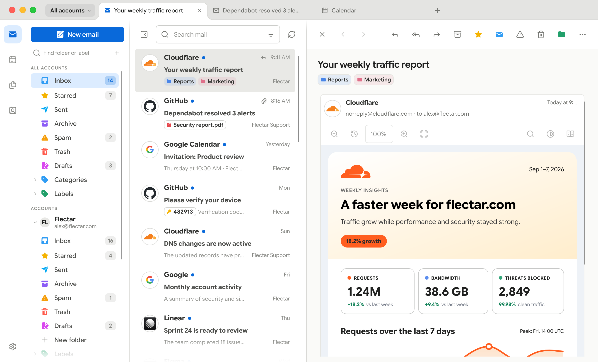
</picture>

Flectar Mail es una aplicación nativa y ligera para tu correo, calendarios y
contactos. Está diseñada para abrirse al instante, responder con fluidez y usar
una fracción de la memoria de un cliente de correo típico basado en tecnologías web.

## ❓ ¿Por qué Flectar Mail?

- **Rápido desde el primer clic.** Una interfaz nativa y un acceso a los datos
  que prioriza el almacenamiento local te llevan a tu bandeja de entrada sin
  esperar a que se cargue un entorno de navegador.
- **Desde tan solo 80 MB de RAM.** Flectar Mail está diseñado para mantener un
  consumo de memoria bajo, incluso con una bandeja de entrada llena de funciones.
- **Todo en un mismo lugar.** Pasa del correo a los calendarios y contactos sin
  tener que combinar varias aplicaciones independientes.
- **Sin conexión por diseño.** Tu buzón y tu calendario se guardan localmente,
  así que los datos sincronizados siguen siendo útiles sin conexión.
- **Compatible con tus cuentas.** Conecta Gmail, Outlook y Microsoft 365, o
  servicios basados en los estándares IMAP, POP3, SMTP, JMAP, CalDAV y CardDAV.
- **Privacidad por defecto.** Las imágenes remotas se bloquean hasta que las
  permites, lo que ayuda a evitar que los píxeles de seguimiento revelen cuándo
  lees un mensaje.
- **Seguridad desde la arquitectura.** El contenido del correo nunca se abre
  en una WebView. Flectar Mail renderiza HTML y CSS con su propio sistema nativo
  en Rust, no ejecuta scripts de los mensajes y bloquea las imágenes remotas
  por defecto. Así evita la superficie de ataque de un navegador integrado.
- **Un renderizador experimental en Rust.** Crear un renderizador de correo
  sin un motor de navegador es un terreno nuevo. Es normal encontrar problemas
  de visualización, especialmente en mensajes complejos, mientras mejora la
  compatibilidad.
- **Para todas las pantallas.** Las vistas de escritorio, amplias o minimalistas,
  comparten la misma experiencia que la interfaz compacta adaptada al uso táctil.
- **Nativo y de código abierto.** Creado desde cero con Rust. No es un navegador
  dentro de una ventana y se distribuye bajo la licencia AGPLv3.

## 📁 Archivos y adjuntos

Explora el almacenamiento JMAP/WebDAV, busca adjuntos, guarda archivos sin
conexión y previsualiza PDF, imágenes y texto.

## ✍🏻 Firmas de cuenta y OpenPGP

Ajustes → Cuentas → Firmas y OpenPGP permite crear firmas con nombre, definir
valores predeterminados distintos para mensajes nuevos y respuestas, y elegir
una firma al redactar. La firma y el cifrado OpenPGP/MIME en el escritorio usan
una instalación de GnuPG 2.x con pinentry para las frases de contraseña de las
claves privadas. Si se exige cifrado, el envío se bloquea cuando faltan claves
de destinatarios o no son válidas; los borradores protegidos permanecen en el
dispositivo hasta pulsar Enviar.

Actualmente no se admiten S/MIME ni OpenPGP en dispositivos móviles.

## 🧪 Renderizado HTML experimental

> [!WARNING]
> El renderizado de correo HTML es actualmente la parte más experimental de
> Flectar Mail. Algunos mensajes, especialmente los que contienen marcado y CSS
> complejos o poco habituales, pueden no mostrarse correctamente todavía.

Para mantener el cliente completamente nativo y el consumo de memoria en torno
a los 80 MB, Flectar Mail renderiza el HTML del correo con
[Blitz](https://github.com/DioxusLabs/blitz), un renderizador HTML/CSS en Rust
del equipo de Dioxus, en lugar de integrar un navegador o una WebView.

Las versiones de escritorio incluyen **CPU — Low Memory** y **GPU — WGPU** en
Ajustes → General → Renderizador. La CPU está seleccionada inicialmente y no
inicializa WGPU. La opción GPU usa Slint y Vello sobre un dispositivo WGPU 30
compartido; el cambio se aplica al reiniciar la aplicación. Si el inicio con
GPU falla, se vuelve automáticamente a la CPU.

Hasta donde sabemos, Flectar Mail es uno de los primeros proyectos que usa
Blitz para renderizar HTML de correos reales de cualquier origen. Los mensajes
contienen mucho HTML y CSS poco habitual, lo que plantea exigencias difíciles
al renderizador. Actualmente mantenemos varios parches sobre Blitz y esperamos
incorporar tantos como sea posible al proyecto original con el tiempo.

Si encuentras un correo que se muestra de forma incorrecta,
[informa del problema](https://github.com/flectar/mail/issues). Este enfoque
sigue siendo experimental, pero también es una de las razones principales por
las que Flectar Mail puede ser tan ligero frente a los clientes basados en
WebView y creados con herramientas como Tauri o Wails.

## 🎨 A tu gusto

Elige la vista que mejor se adapte a tu forma de gestionar el correo. Mantén la
vista detallada de tres paneles, cambia a una vista minimalista, elige un tema
claro u oscuro, selecciona una paleta de colores incluida o crea una propia,
y muestra u oculta los avatares de los remitentes. También puedes darle otro
color al icono de la aplicación: en la barra de tareas o el Dock, en la bandeja
del sistema, en el lanzador de aplicaciones de Linux y en la pantalla de inicio
de Android e iOS.

La apariencia de los mensajes puede seguir el tema de la aplicación o mantenerse
clara u oscura de forma independiente. Usa la paleta seleccionada para HTML,
texto sin formato y modo de lectura. Para ver temporalmente los colores
originales del remitente, usa el icono de contraste entre Buscar y el modo de
lectura en la barra de herramientas del mensaje en el escritorio, o selecciona
**Mostrar colores originales** en el menú de tres puntos del mensaje en
cualquier tamaño de pantalla.

La vista completa mantiene visibles las carpetas, la lista de mensajes y el
correo seleccionado. La vista minimalista reduce las distracciones y da más
espacio a cada parte de tu bandeja de entrada cuando lo necesitas.

### 👥 Perfiles y colores de cuenta

Agrupa cuentas relacionadas en perfiles con nombre, como Trabajo o Personal,
y asigna un color a cada perfil. Crea un perfil desde el menú de perfiles al
inicio de la barra de pestañas, o en Ajustes → Cuentas → Perfiles, y marca las
cuentas que le pertenecen. Elige un perfil en ese menú para centrar la vista
de correo en sus cuentas: la bandeja de entrada unificada, la búsqueda, los
contadores y la barra lateral solo mostrarán su correo, mientras que las
pestañas seguirán igual. **Todas las cuentas** vuelve a mostrarlo todo.

También puedes cambiar el color de una cuenta concreta y mostrar el color
resultante en el borde izquierdo de cada mensaje. Estos indicadores facilitan
distinguir las cuentas en la bandeja de entrada unificada; el ejemplo siguiente
usa morado para Trabajo y naranja para Soporte.

<picture>
  <source media="(prefers-color-scheme: dark)" srcset="../../resources/screenshots/desktop-profiles-dark.png">
  <source media="(prefers-color-scheme: light)" srcset="../../resources/screenshots/desktop-profiles-light.png">
  
</picture>

### 🧵 Conversaciones

Las respuestas se agrupan en orden cronológico, con el mensaje activo desplegado
en el panel de lectura.

Usa **Arriba/Abajo** para recorrer los mensajes, **Inicio/Fin** para ir al
primer o último mensaje cargado y **Re Pág/Av Pág** para avanzar una página.
**Intro** abre el mensaje actual y lleva el foco a su contenido; **Espacio** lo
marca o desmarca para acciones en grupo. **Tab/Mayús+Tab** permiten pasar de un
control a otro. En la vista completa, **F6** mueve el foco entre la lista de
mensajes y el lector. En la vista minimalista, las flechas resaltan mensajes y
**Intro** los abre; **Esc** o **F6** vuelve a la lista.

<picture>
  <source media="(prefers-color-scheme: dark)" srcset="../../resources/screenshots/desktop-thread-dark.png">
  <source media="(prefers-color-scheme: light)" srcset="../../resources/screenshots/desktop-thread-light.png">
  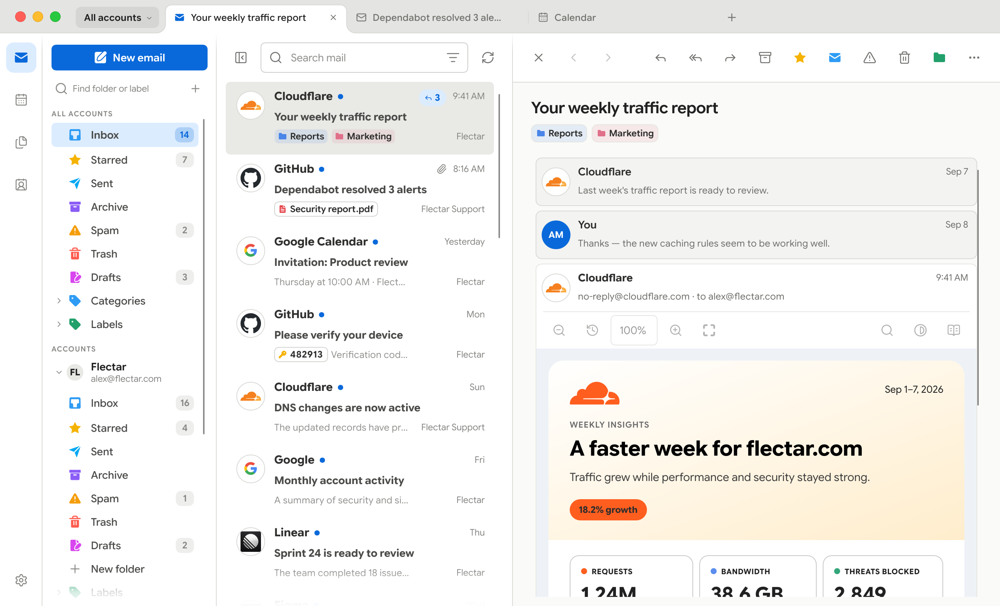
</picture>

### 🗂️ Pestañas

Mantén varios espacios abiertos a la vez con pestañas como las de un navegador.
Cada pestaña recuerda su ubicación: un buzón, una búsqueda, una conversación
abierta, el calendario, los contactos, los archivos o los ajustes, además de
la posición de desplazamiento y el mensaje que estabas leyendo. Haz clic con
el botón central o Ctrl/⌘+clic en un mensaje para abrirlo en una pestaña en
segundo plano (añade Mayús para cambiar a ella), o elige **Abrir en una nueva
pestaña** en su menú. Arrastra las pestañas para reordenarlas, haz clic con el
botón central para cerrarlas y usa el botón derecho para cerrar las demás o las
que están a su derecha. La próxima vez que abras Flectar Mail podrás continuar
donde lo dejaste.

**Ctrl/⌘+T** abre una pestaña, **Ctrl/⌘+W** cierra la actual y
**Ctrl/⌘+Mayús+T** recupera la última que cerraste. **Ctrl+Tab** y
**Ctrl+Mayús+Tab** recorren las pestañas, **Ctrl/⌘+1–8** van a una pestaña
concreta y **Ctrl/⌘+9** va a la última.

<picture>
  <source media="(prefers-color-scheme: dark)" srcset="../../resources/screenshots/desktop-tabs-dark.png">
  <source media="(prefers-color-scheme: light)" srcset="../../resources/screenshots/desktop-tabs-light.png">
  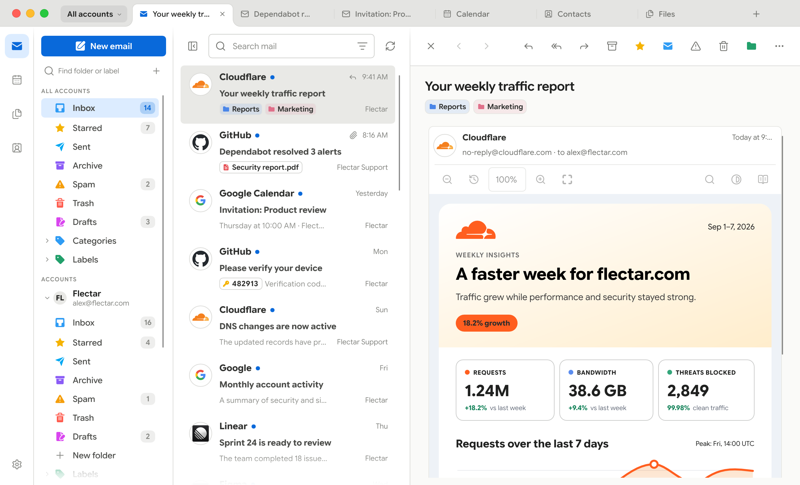
</picture>

### Vistas completa y minimalista

<table>
  <thead>
    <tr>
      <th width="50%">Vista completa</th>
      <th width="50%">Vista minimalista</th>
    </tr>
  </thead>
  <tbody>
    <tr>
      <td width="50%">
        <picture>
          <source media="(prefers-color-scheme: dark)" srcset="../../resources/screenshots/desktop-dark.png">
          <source media="(prefers-color-scheme: light)" srcset="../../resources/screenshots/desktop-light.png">
          
        </picture>
      </td>
      <td width="50%">
        <picture>
          <source media="(prefers-color-scheme: dark)" srcset="../../resources/screenshots/desktop-minimal-dark.png">
          <source media="(prefers-color-scheme: light)" srcset="../../resources/screenshots/desktop-minimal-light.png">
          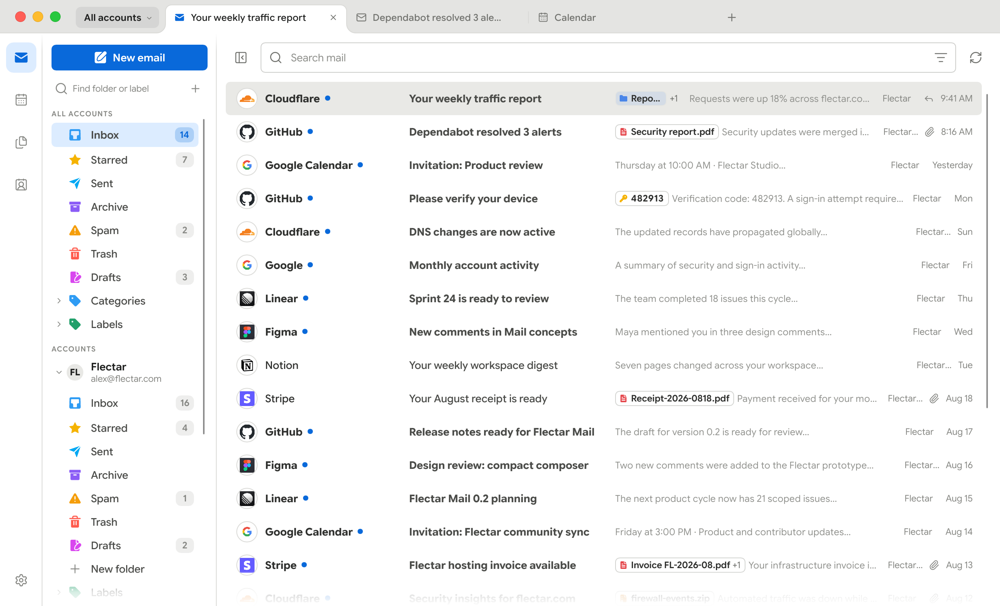
        </picture>
      </td>
    </tr>
  </tbody>
</table>

### Paletas de colores

<table>
  <thead>
    <tr>
      <th width="25%">Verde azulado</th>
      <th width="25%">Verde</th>
      <th width="25%">Morado</th>
      <th width="25%">Personalizada</th>
    </tr>
  </thead>
  <tbody>
    <tr>
      <td width="25%">
        <picture>
          <source media="(prefers-color-scheme: dark)" srcset="../../resources/screenshots/desktop-teal-dark.png">
          <source media="(prefers-color-scheme: light)" srcset="../../resources/screenshots/desktop-teal-light.png">
          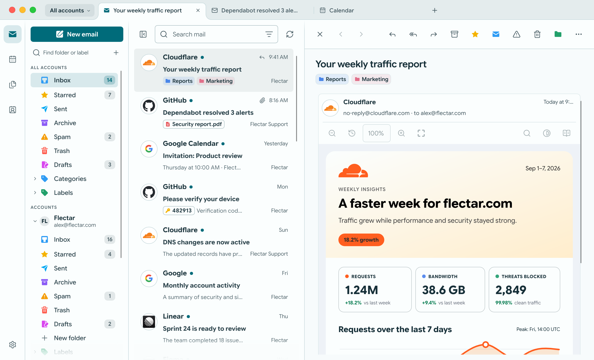
        </picture>
      </td>
      <td width="25%">
        <picture>
          <source media="(prefers-color-scheme: dark)" srcset="../../resources/screenshots/desktop-green-dark.png">
          <source media="(prefers-color-scheme: light)" srcset="../../resources/screenshots/desktop-green-light.png">
          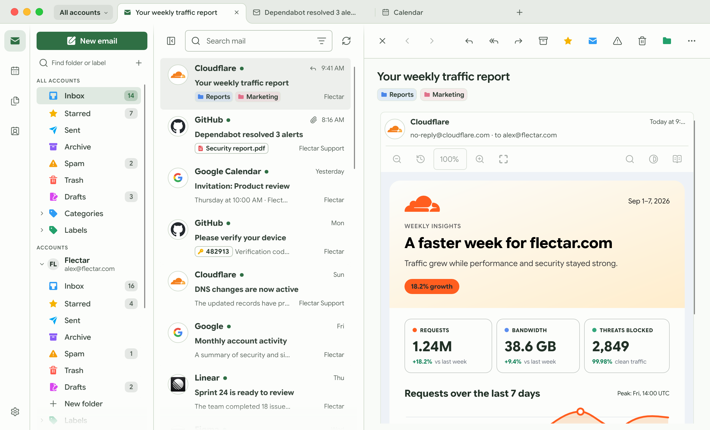
        </picture>
      </td>
      <td width="25%">
        <picture>
          <source media="(prefers-color-scheme: dark)" srcset="../../resources/screenshots/desktop-purple-dark.png">
          <source media="(prefers-color-scheme: light)" srcset="../../resources/screenshots/desktop-purple-light.png">
          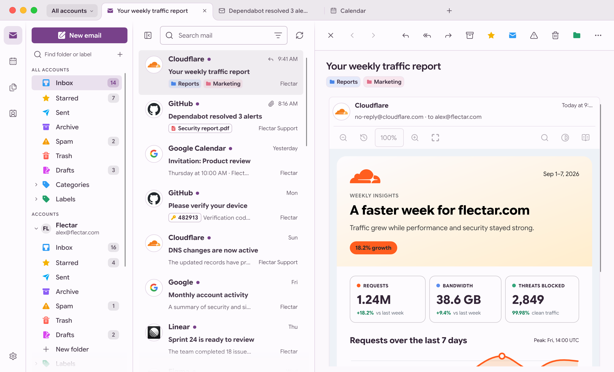
        </picture>
      </td>
      <td width="25%">
        <picture>
          <source media="(prefers-color-scheme: dark)" srcset="../../resources/screenshots/desktop-dark.png">
          <source media="(prefers-color-scheme: light)" srcset="../../resources/screenshots/desktop-light.png">
          
        </picture>
      </td>
    </tr>
  </tbody>
</table>

### 🪟 Ventana sin marco

Activa **Ventana sin marco** en Ajustes → General → Interfaz para sustituir la
barra de título del sistema por controles de ventana en la barra de herramientas.
Cada plataforma conserva su comportamiento: macOS mantiene sus botones nativos
de colores, Windows conserva Snap Layouts y el menú del sistema, y Linux respeta
el orden de los botones y las acciones de la barra de título configurados en
GNOME o KDE.

<table>
  <tbody>
    <tr>
      <th width="50%">macOS</th>
      <th width="50%">Windows</th>
    </tr>
    <tr>
      <td width="50%">
        <picture>
          <source media="(prefers-color-scheme: dark)" srcset="../../resources/screenshots/frameless/macos-dark.png">
          <source media="(prefers-color-scheme: light)" srcset="../../resources/screenshots/frameless/macos-light.png">
          
        </picture>
      </td>
      <td width="50%">
        <picture>
          <source media="(prefers-color-scheme: dark)" srcset="../../resources/screenshots/frameless/windows-dark.png">
          <source media="(prefers-color-scheme: light)" srcset="../../resources/screenshots/frameless/windows-light.png">
          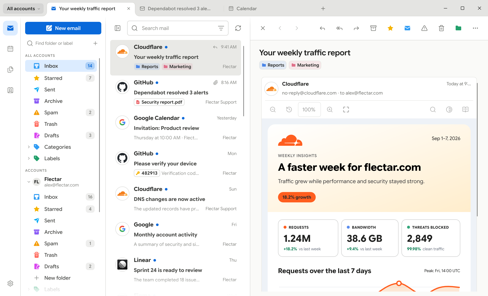
        </picture>
      </td>
    </tr>
    <tr>
      <th width="50%">Linux (GNOME)</th>
      <th width="50%">Linux (KDE)</th>
    </tr>
    <tr>
      <td width="50%">
        <picture>
          <source media="(prefers-color-scheme: dark)" srcset="../../resources/screenshots/frameless/linux-gnome-dark.png">
          <source media="(prefers-color-scheme: light)" srcset="../../resources/screenshots/frameless/linux-gnome-light.png">
          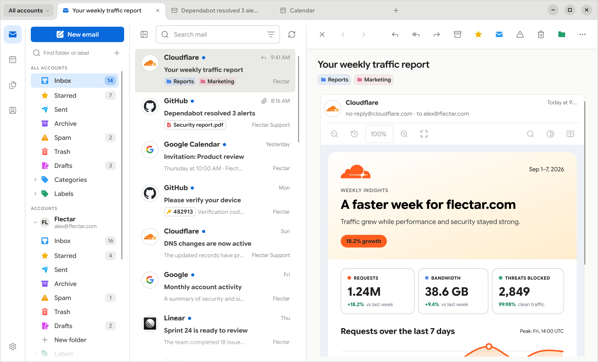
        </picture>
      </td>
      <td width="50%">
        <picture>
          <source media="(prefers-color-scheme: dark)" srcset="../../resources/screenshots/frameless/linux-kde-dark.png">
          <source media="(prefers-color-scheme: light)" srcset="../../resources/screenshots/frameless/linux-kde-light.png">
          
        </picture>
      </td>
    </tr>
  </tbody>
</table>

### 📅 Calendario, contactos y archivos

<table>
  <thead>
    <tr>
      <th width="33.33%">Calendario</th>
      <th width="33.33%">Contactos</th>
      <th width="33.33%">Archivos (WebDAV/JMAP)</th>
    </tr>
  </thead>
  <tbody>
    <tr>
      <td width="33.33%">
        <picture>
          <source media="(prefers-color-scheme: dark)" srcset="../../resources/screenshots/desktop-calendar-dark.png">
          <source media="(prefers-color-scheme: light)" srcset="../../resources/screenshots/desktop-calendar-light.png">
          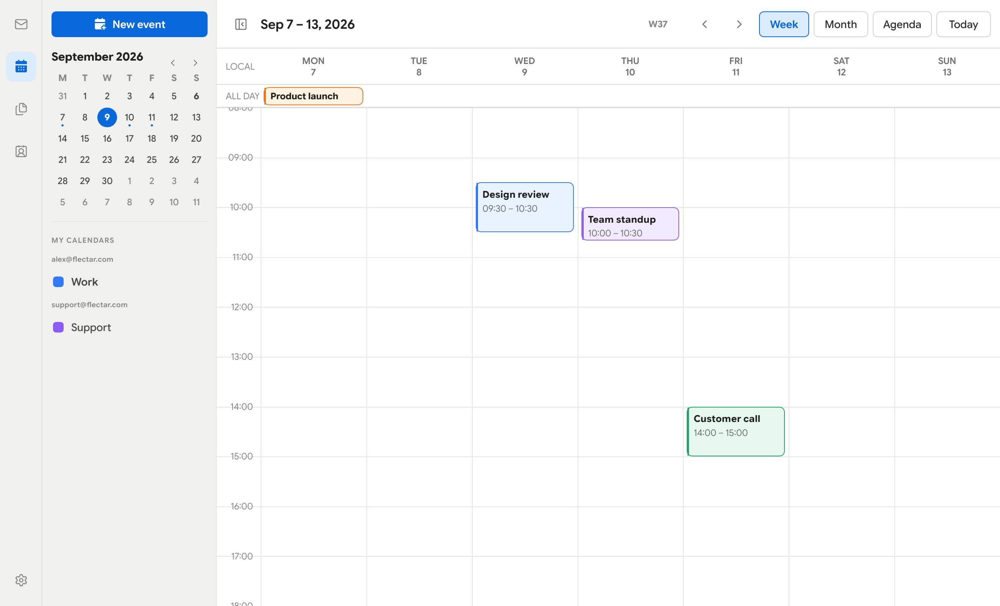
        </picture>
      </td>
      <td width="33.33%">
        <picture>
          <source media="(prefers-color-scheme: dark)" srcset="../../resources/screenshots/desktop-contacts-dark.png">
          <source media="(prefers-color-scheme: light)" srcset="../../resources/screenshots/desktop-contacts-light.png">
          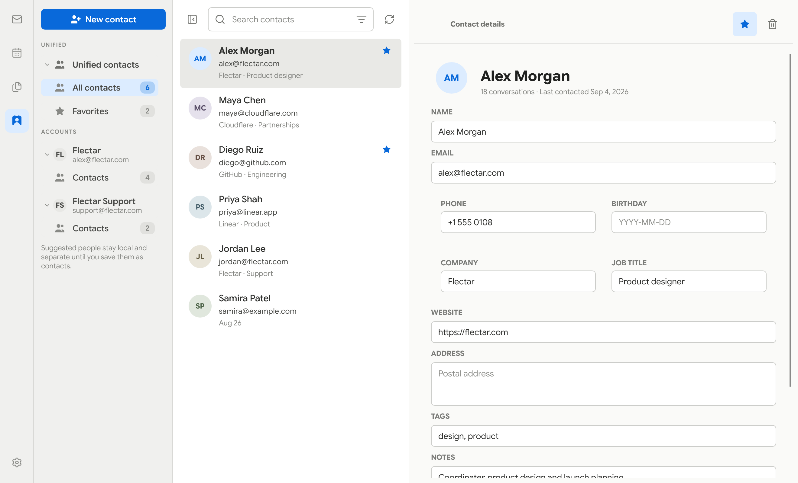
        </picture>
      </td>
      <td width="33.33%">
        <picture>
          <source media="(prefers-color-scheme: dark)" srcset="../../resources/screenshots/desktop-files-dark.png">
          <source media="(prefers-color-scheme: light)" srcset="../../resources/screenshots/desktop-files-light.png">
          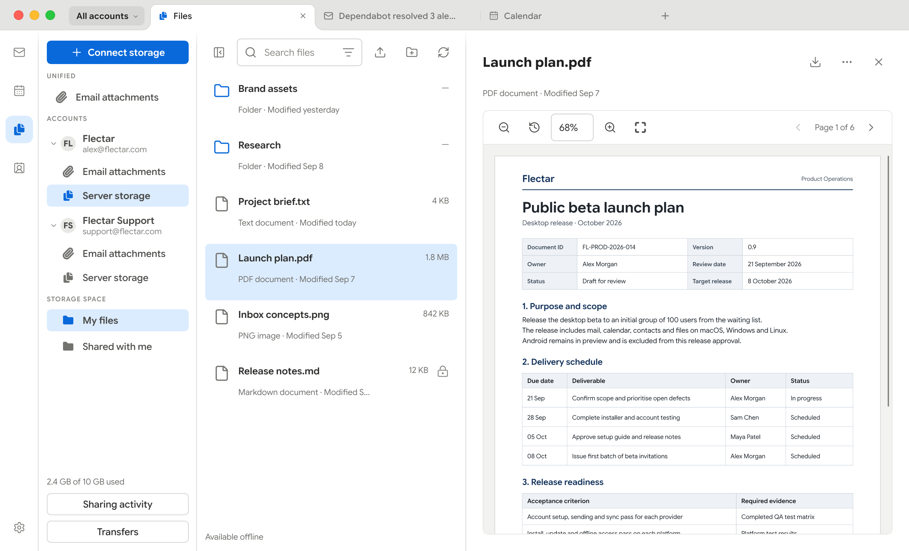
        </picture>
      </td>
    </tr>
  </tbody>
</table>

### 💾 Almacenamiento y copias de seguridad

Ajustes → Almacenamiento muestra cuánto espacio ocupan el correo, los adjuntos,
los archivos sin conexión y las bases de datos en el dispositivo. Desde la
misma página puedes exportar instantáneas verificadas de las bases de datos o
transferir la configuración de las cuentas conectadas y las preferencias
mediante una copia de seguridad. Las contraseñas y los tokens OAuth permanecen
en el llavero del sistema, así que el dispositivo restaurado te pedirá que
vuelvas a iniciar sesión.

Las cuentas POP3 descargan el correo en este dispositivo y lo dejan en el
servidor salvo que elijas lo contrario: cada cuenta puede eliminarlo del
servidor a los 7, 14 o 30 días, cuando lo borres aquí o en cuanto se descargue,
pero nunca antes de guardarlo en este dispositivo. Sus carpetas solo existen
en este dispositivo, por lo que las instantáneas incluyen ese correo. Al
eliminar una cuenta POP3 o todos los datos, se ofrece exportarlo primero como
archivos mbox, uno por carpeta, que otras aplicaciones de correo pueden importar.

La misma función de importación también permite traer cuentas de Thunderbird
(una carpeta de perfil, su archivo de Herramientas › Exportar o `prefs.js`) y de
Thunderbird para Android o K-9 Mail (exportaciones de ajustes `.k9s`). Puedes
revisar cada cuenta antes de añadirla: los ajustes que Flectar Mail no puede
reproducir, como un servidor Exchange, se explican en lugar de cambiarse sin
avisar, y las cuentas POP3 conservan su regla de eliminación del correo del
servidor. Las cuentas existentes nunca se modifican y las contraseñas nunca
se importan.

<picture>
  <source media="(prefers-color-scheme: dark)" srcset="../../resources/screenshots/desktop-storage-dark.png">
  <source media="(prefers-color-scheme: light)" srcset="../../resources/screenshots/desktop-storage-light.png">
  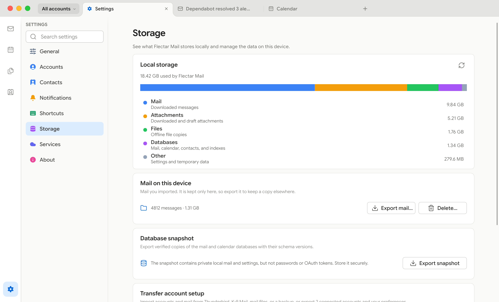
</picture>

### 📱 Para pantallas pequeñas

La interfaz compacta mantiene las acciones importantes al alcance y deja toda
la pantalla a los mensajes, eventos y contactos cuando la necesitan.

| Claro | Oscuro |
| --- | --- |
| 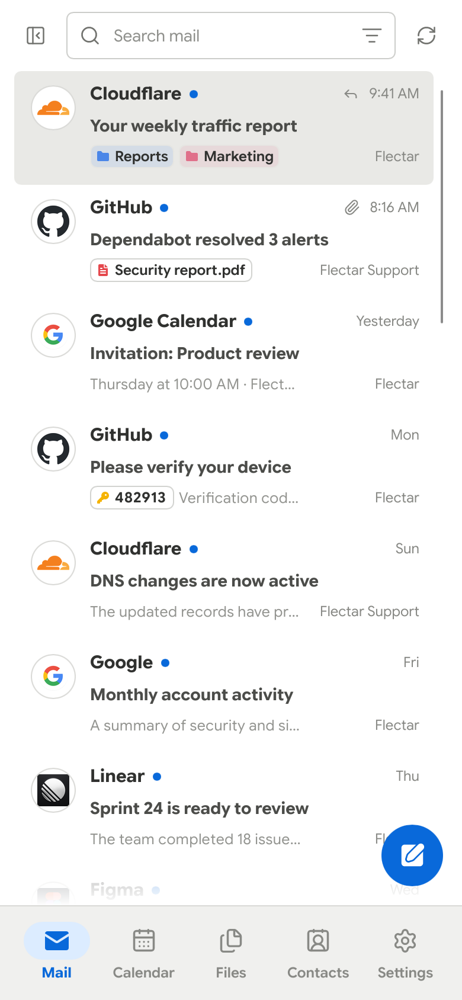 | 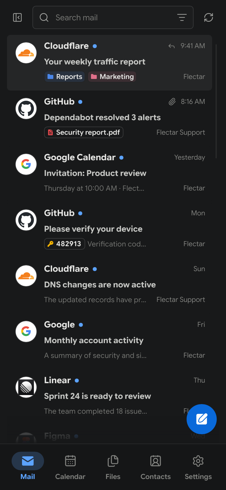 |

## 📥 Consigue Flectar Mail

Flectar Mail está en desarrollo y todavía no es estable.

> [!WARNING]
> **La verificación OAuth de Google requiere una evaluación de seguridad CASA
> anual.** Flectar es un proyecto comunitario de código abierto, por lo que
> completar esta evaluación depende del apoyo de patrocinadores. Hasta que la
> verificación necesaria esté financiada y completada, no será posible publicar
> una versión estable con OAuth de Gmail configurado por defecto. Si quieres
> ayudar a ofrecer el inicio de sesión integrado de Gmail,
> [patrocina Flectar](https://github.com/sponsors/flectar).
>
> La verificación OAuth de Google y Microsoft sigue en curso. Las versiones
> preliminares anteriores de GitHub están pensadas para quienes prueban la
> aplicación con sus propios registros OAuth o con cuentas IMAP, POP3 o JMAP.

Las compilaciones sin claves de aplicación OAuth mantienen desactivado el
inicio de sesión en Gmail y Outlook. Usa el engranaje de **Ajustes de inicio
de sesión** de la pantalla de bienvenida para guardar tu propio registro de
aplicación de Google o Microsoft, o conecta una cuenta IMAP, POP3 o JMAP. Las
claves personalizadas se comparten con Ajustes y tienen prioridad sobre las
incluidas; al borrar un ID de cliente personalizado se recuperan los valores
predeterminados, si están disponibles. Cada proveedor se activa por separado
cuando se guarda su configuración.

Cuando se publiquen versiones de prueba, descárgalas desde
[GitHub Releases](https://github.com/flectar/mail/releases) y busca la etiqueta
**Pre-release**:

- **Linux x64:** AppImage, `.deb` para Debian/Ubuntu, `.rpm` para Fedora 43/44 o
  un paquete Flatpak de prueba para instalar manualmente
- **Windows x64:** Instalador `.exe` o ZIP portátil
- **macOS con Apple silicon o Intel (macOS 14+):** DMG o ZIP de la aplicación
- **Android arm64 (Android 8.0+):** APK firmado; las versiones de prueba y las
  estables comparten una misma identidad de aplicación

Las versiones de prueba de Windows no están firmadas; las de macOS usan firma
ad hoc y no están notarizadas, por lo que es normal que el sistema operativo
muestre avisos de seguridad. Las actualizaciones se instalan manualmente.

La versión de prueba de Flatpak se distribuye como paquete independiente.
Todavía no está en Flathub y, por tanto, no recibe actualizaciones automáticas
de Flathub. La opción de cerrar a la bandeja del sistema está desactivada hasta
que el componente de la bandeja pueda usar un nombre D-Bus compatible con el
entorno aislado. El inicio automático al iniciar sesión usa el portal Background
del escritorio y abre la ventana, ya que no hay una bandeja en la que iniciarse.
Allí el icono de la aplicación se mantiene naranja, porque el entorno aislado no
puede cambiar el icono del lanzador en el sistema.

Instala el paquete de Linux descargado con
`sudo dnf install ./flectar-mail-<version>-linux-x64.rpm` o
`flatpak install --user ./flectar-mail-<version>-linux-x64.flatpak`. Inicia
Flatpak con `flatpak run com.flectar.mail`.

El RPM está destinado a Fedora 43 y 44 en x86_64. Las compilaciones de publicación
usan Fedora 43 como base de compatibilidad; el mismo RPM debe superar las
comprobaciones de instalación, renderizado de PDF, inicio con X11 y Wayland, y
desinstalación en contenedores limpios de ambas versiones antes de publicarse.
Otras distribuciones basadas en RPM todavía no se han probado. Si Discover
muestra un conflicto genérico, ejecuta el comando `dnf install` anterior e
incluye el error de dependencias en tu informe.

El RPM anterior, `0.1.0-alpha.7`, se compiló en Fedora 44 y no puede instalarse
en Fedora 43 porque requiere glibc 2.43. Su paquete Flatpak es una alternativa
mientras llega una versión RPM creada con las comprobaciones de compatibilidad
anteriores.

Cada publicación de GitHub incluye `SHA256SUMS` y certificaciones firmadas de
procedencia de la compilación. Con GitHub CLI instalado, verifica una descarga
con `gh attestation verify <download> --repo flectar/mail`.

A partir de alpha 8, las compilaciones alpha, beta, candidatas a versión estable
y estables de Android usan un único paquete (`com.flectar.mail`) y una identidad
de firma persistente. Las versiones posteriores pueden actualizar la aplicación
sin reinstalarla y conservar los datos locales. Alpha 6 y alpha 7 usaban claves
distintas y no pueden actualizarse a esta identidad de firma.

Los dos flujos de publicación de Android usan el entorno de GitHub
`android-release`. Requieren los mismos secretos del almacén de claves y de las
contraseñas, comprueban el certificado público frente a
`platform/android/app-signing-certificate.sha256` y calculan los códigos de
versión de Android a partir de la versión publicada. Si falta una clave o es
distinta, la publicación se bloquea. **No generes una clave de sustitución ni
cambies la huella fijada para una publicación habitual.** Cambiar las
contraseñas conserva la identidad si se mantienen la clave privada y el
certificado originales.

Consulta la [configuración y recuperación de la firma de Android](../android-signing.md)
para conocer el comando de migración que solo debe ejecutarse una vez, los
secretos necesarios, las copias de seguridad y Play App Signing.

Las compilaciones locales de desarrollo pueden seguir generando una clave de
prueba local. Solo actualizan instalaciones firmadas con esa misma clave.

También puedes compilar Flectar Mail desde el código fuente con las
[herramientas de Rust](https://rustup.rs/):

```bash
cargo run --bin flectar-mail
```

OAuth en el escritorio Linux usa el navegador del sistema a través del portal
del escritorio y guarda las credenciales de renovación mediante freedesktop
Secret Service. Por tanto, una sesión de escritorio normal necesita un
componente `xdg-desktop-portal` y un proveedor de Secret Service como GNOME
Keyring. Las compilaciones de publicación se detienen antes de abrir la página
OAuth cuando no hay almacenamiento seguro de credenciales, para que una
autorización nunca se complete sin un lugar seguro donde guardarla.

Los entornos de desarrollo de Podman y Docker normalmente no tienen acceso al
D-Bus de la sesión anfitriona ni a la red de bucle local del navegador anfitrión.
Las compilaciones de depuración permiten trabajar así con un archivo de
credenciales de desarrollo claramente identificado y accesible solo por su
propietario, y un panel desplegable para pegar la URL final de retorno de bucle
local. Este almacenamiento en archivo se excluye de las compilaciones de
publicación.

## 🌍 Ayuda a traducir Flectar Mail

Flectar Mail está pensado para todo el mundo y nos encantaría contar con tu
ayuda para ofrecerlo en más idiomas.

Usamos [Weblate](https://translate.flectar.com/) para gestionar las traducciones
de la comunidad. Puedes traducir Flectar Mail a tu lengua materna, mejorar una
traducción existente o revisar textos traducidos. Toda contribución es bienvenida.

**[Empieza a traducir Flectar Mail →](https://translate.flectar.com/)**

Empezar es fácil:

1. Crea una cuenta en nuestra plataforma de traducción.
2. Selecciona tu idioma o inicia una traducción si aún no está disponible.
3. Traduce los textos directamente en Weblate, sin necesidad de saber programar
   ni de tener experiencia con GitHub.

Las traducciones se sincronizan con nuestro repositorio de GitHub y se envían
como solicitudes de cambios para su revisión. Las personas que contribuyen
también pueden recibir reconocimiento por su trabajo en GitHub.

Las traducciones del README se mantienen en este repositorio. Consulta la
[guía para contribuir traducciones](../../CONTRIBUTING.md#translations) para añadir o
actualizar una.

## ♿ Accesibilidad

Flectar Mail incluye navegación con teclado, temas claros y oscuros y diseños
flexibles. Seguimos trabajando en la accesibilidad. Consulta
[ACCESSIBILITY.md](../../ACCESSIBILITY.md) para conocer las funciones actuales, las
limitaciones de las pruebas y cómo informar de una barrera de accesibilidad.

## 🔒 Seguridad

Para informar de una vulnerabilidad de forma privada, sigue las indicaciones
de [SECURITY.md](../../SECURITY.md). No publiques detalles de vulnerabilidades en
informes de problemas públicos.

## 🌐 Código abierto para todos

Flectar Mail es una única aplicación de código abierto. No hay una edición
comunitaria separada. El cliente se distribuye bajo la
[Licencia Pública General Affero de GNU v3](../../LICENSE). Lee la
[descripción de las licencias](../../LICENSING.md) para conocer los detalles prácticos,
o consulta [CONTRIBUTING.md](../../CONTRIBUTING.md) para ayudar a dar forma al proyecto.

## 🫡 Agradecimientos

Flectar Mail es posible gracias al trabajo de estos proyectos y de quienes
contribuyen a ellos:

- [Slint](https://slint.dev/), el conjunto de herramientas de interfaz nativa
  que da vida a la interfaz de Flectar Mail.
- [Blitz](https://github.com/DioxusLabs/blitz), el renderizador HTML/CSS en Rust
  del equipo de Dioxus que permite leer los mensajes de correo.

---
