

  
  <h1 align="center">
    Flectar Mail
  </h1>
  

    <a href="../../README.md">English</a> · <a href="README.es.md">Español</a> · <a href="README.de.md">Deutsch</a> ·
    <strong>Français</strong> · <a href="README.pt_BR.md">Português (Brasil)</a> · <a href="README.ru.md">Русский</a> ·
    <a href="README.hi.md">हिन्दी</a> · <a href="README.ar.md">العربية</a> · <a href="README.zh_Hans.md">简体中文</a>
  

  

    <h3>L’e-mail retrouve sa rapidité</h3>
    
Conçu de zéro pour la vitesse. Flectar Mail offre des performances natives, un démarrage instantané et une consommation d’environ 20 Mo de mémoire privée au repos.

  

  

    <a href="https://flectar.com">Site web</a> ·
    <a href="https://github.com/flectar/mail/issues">Signaler un problème</a> ·
    <a href="../../CONTRIBUTING.md">Contribuer</a>
  

  

    
    
    
    
  

  

    
    
  

<picture>
  <source media="(prefers-color-scheme: dark)" srcset="../../resources/screenshots/desktop-dark.png">
  <source media="(prefers-color-scheme: light)" srcset="../../resources/screenshots/desktop-light.png">
  
</picture>

Flectar Mail est une application native et légère pour vos e-mails, calendriers et contacts. Elle est conçue pour s’ouvrir instantanément, rester réactive et n’utiliser qu’une fraction de la mémoire d’un client de messagerie classique basé sur des technologies web.

## ❓ Pourquoi Flectar Mail ?

| Avantage | Détails |
| --- | --- |
| **Rapide dès le premier clic** | Une interface native et un accès aux données privilégiant le stockage local vous conduisent à votre boîte de réception sans attendre le démarrage d’un environnement de navigateur. |
| **Environ 20 Mo de mémoire privée au repos** | Environ 85 Mo en comptant son code et ses bibliothèques, et un douzième de la mémoire privée de Thunderbird avec la même boîte aux lettres. Voir [Performances](#-performances). |
| **Tout au même endroit** | Passez de la messagerie aux calendriers et aux contacts sans devoir assembler plusieurs applications. |
| **Pensé pour fonctionner hors ligne** | Votre messagerie et votre calendrier sont stockés localement : vos données synchronisées restent donc utiles sans connexion. |
| **Compatible avec vos comptes** | Gmail, Outlook et Microsoft 365, ou des services reposant sur IMAP, POP3, SMTP, JMAP, CalDAV et CardDAV. |
| **La confidentialité par défaut** | Les images distantes sont bloquées jusqu’à votre autorisation, pour que les pixels de suivi ne puissent pas signaler quand vous lisez un message. |
| **La sécurité dès l’architecture** | Les e-mails ne sont jamais ouverts dans une WebView. Un système natif en Rust affiche leur HTML et leur CSS sans exécuter les scripts qu’ils contiennent, ce qui évite la surface d’attaque d’un navigateur intégré. |
| **Un moteur de rendu expérimental en Rust** | Afficher des e-mails sans moteur de navigateur est un terrain nouveau. Les messages complexes peuvent encore s’afficher incorrectement, le temps que la compatibilité s’améliore. |
| **Pour tous les écrans** | Les interfaces de bureau, complète et minimaliste, partagent la même expérience que l’interface compacte adaptée au tactile. |
| **Natif et libre** | Créé de zéro en Rust. Il ne s’agit pas d’un navigateur dans une fenêtre ; l’application est distribuée sous AGPLv3. |

## ⚡ Performances

| Au repos, même boîte aux lettres | Mémoire privée | Y compris le code et les bibliothèques (PSS) | Rendu des e-mails |
| --- | ---: | ---: | --- |
| **Flectar Mail** | **17,2–17,4 Mio** | **79,1–80,0 Mio** | Blitz |
| Geary 46 | 126,1–126,2 Mio | 309,6–311,4 Mio | WebKitGTK |
| Evolution 3.56 | 191,0–192,2 Mio | 395,0–395,9 Mio | WebKitGTK |
| Thunderbird 159 | 244,1–248,1 Mio | 424,4–427,1 Mio | Gecko |
| Betterbird 153 | 243,9–247,8 Mio | 411,9–419,7 Mio | Gecko |
| Mailspring 1.26 | 311,4–314,9 Mio | 551,1–551,7 Mio | Chromium |
| Aerion 0.3.6 | 421,9–437,3 Mio | 660,4–678,0 Mio | WebKitGTK |

Mesures effectuées sur Linux avec un compte IMAP (860 messages), la boîte de réception ouverte et une newsletter HTML affichée, 60 secondes après le lancement, avec le moteur de rendu CPU par défaut. Chaque fourchette couvre deux mesures, et tous les processus lancés par chaque application sont comptés. La mémoire privée correspond à la colonne **Mémoire** du Gestionnaire des tâches de Windows. Sous Windows, avec 7 comptes réels et environ 69 000 messages non lus, le Gestionnaire des tâches affichait 37,8 Mio avec la fenêtre ouverte et 4,2 Mio une fois celle-ci fermée dans la zone de notification. Découvrez [comment nous mesurons et comment vérifier ces chiffres par vous-même](../performance.md).

### Comparatif

| Client de messagerie | Interface | Rendu des e-mails | Plateformes |
| --- | --- | --- | --- |
| **Flectar Mail** | Application native en Rust | Blitz, un moteur HTML/CSS en Rust ; aucune WebView | Windows, macOS, Linux, Android, iOS (par sideloading) |
| Thunderbird | Application de bureau basée sur Gecko | Gecko | Windows, macOS, Linux, Android |
| Outlook pour Windows | Application Windows à interface web | Microsoft Edge WebView2 | Windows |
| Spark | Application Electron | Chromium | macOS, Windows, iOS, Android |
| Aerion | Application Go avec une interface web Wails | WebView du système | Linux, macOS, Windows |
| Gmail dans un onglet de navigateur | Application web | Chrome ou un autre navigateur | Web |

## ✨ Fonctionnalités

| Fonctionnalité | Ce qu’elle fait |
| --- | --- |
| [Fils de discussion](../features.md#conversation-threads) | Regroupe les réponses par ordre chronologique, avec une navigation complète au clavier. Vous pouvez désactiver ce regroupement. |
| [Onglets](../features.md#tabs) | Des onglets comme dans un navigateur, qui retiennent où vous en étiez, avec des raccourcis sur ordinateur et un sélecteur d’onglets sur mobile. |
| [Profils et couleurs des comptes](../features.md#profiles-and-account-colors) | Regroupe les comptes dans des profils, comme Travail ou Personnel, et attribue un code couleur à chaque message. |
| [Apparence](../features.md#appearance) | Disposition complète ou minimaliste, thème clair ou sombre, palettes de couleurs, avatars des expéditeurs et couleurs de l’icône de l’application. |
| [Fenêtre sans bordure](../features.md#frameless-window) | Des contrôles de fenêtre dans la barre d’outils, qui conservent le comportement propre à chaque plateforme. |
| [Calendrier, contacts et fichiers](../features.md#calendar-contacts-and-files) | Synchronisation CalDAV et CardDAV, fichiers JMAP et WebDAV, recherche dans les pièces jointes, fichiers hors ligne et aperçus. |
| [Signatures et OpenPGP](../features.md#signatures-and-openpgp) | Signatures nommées, ainsi que signature et chiffrement OpenPGP/MIME sur ordinateur avec GnuPG. |
| [Stockage et sauvegardes](../features.md#storage-and-backups) | Espace utilisé par type de données, instantanés des bases de données, sauvegardes des comptes et règles de suppression sur le serveur POP3. |
| [Importation des comptes et des e-mails](../features.md#importing-accounts-and-mail) | Thunderbird, K-9 Mail, mbox, `.eml`, maildir, Apple Mail et archives ZIP. |
| [Rendu HTML](../features.md#html-rendering) | Affiche le HTML des e-mails en Rust avec Blitz, sur le CPU ou le GPU. |

### Espaces de travail complet et minimaliste

<table>
  <thead>
    <tr>
      <th width="50%">Espace complet</th>
      <th width="50%">Espace minimaliste</th>
    </tr>
  </thead>
  <tbody>
    <tr>
      <td width="50%">
        <picture>
          <source media="(prefers-color-scheme: dark)" srcset="../../resources/screenshots/desktop-dark.png">
          <source media="(prefers-color-scheme: light)" srcset="../../resources/screenshots/desktop-light.png">
          
        </picture>
      </td>
      <td width="50%">
        <picture>
          <source media="(prefers-color-scheme: dark)" srcset="../../resources/screenshots/desktop-minimal-dark.png">
          <source media="(prefers-color-scheme: light)" srcset="../../resources/screenshots/desktop-minimal-light.png">
          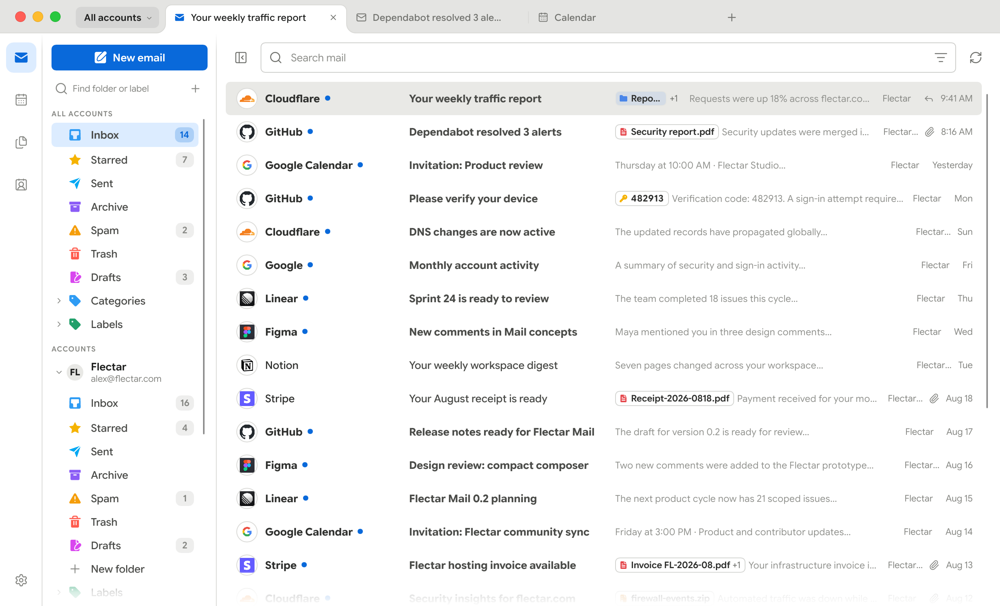
        </picture>
      </td>
    </tr>
  </tbody>
</table>

### Onglets, conversations et profils

<table>
  <thead>
    <tr>
      <th width="33.33%">Onglets</th>
      <th width="33.33%">Conversation</th>
      <th width="33.33%">Couleurs des profils</th>
    </tr>
  </thead>
  <tbody>
    <tr>
      <td width="33.33%">
        <picture>
          <source media="(prefers-color-scheme: dark)" srcset="../../resources/screenshots/desktop-tabs-dark.png">
          <source media="(prefers-color-scheme: light)" srcset="../../resources/screenshots/desktop-tabs-light.png">
          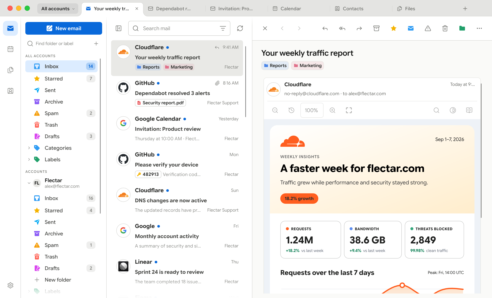
        </picture>
      </td>
      <td width="33.33%">
        <picture>
          <source media="(prefers-color-scheme: dark)" srcset="../../resources/screenshots/desktop-thread-dark.png">
          <source media="(prefers-color-scheme: light)" srcset="../../resources/screenshots/desktop-thread-light.png">
          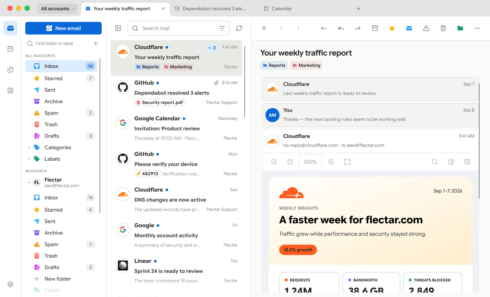
        </picture>
      </td>
      <td width="33.33%">
        <picture>
          <source media="(prefers-color-scheme: dark)" srcset="../../resources/screenshots/desktop-profiles-dark.png">
          <source media="(prefers-color-scheme: light)" srcset="../../resources/screenshots/desktop-profiles-light.png">
          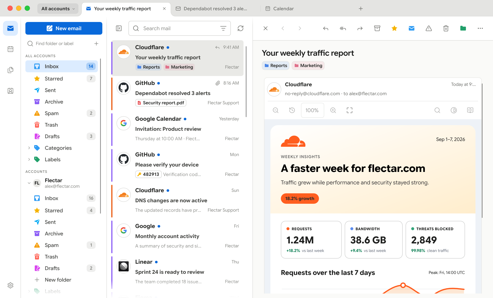
        </picture>
      </td>
    </tr>
  </tbody>
</table>

### Palettes de couleurs

<table>
  <thead>
    <tr>
      <th width="25%">Bleu-vert</th>
      <th width="25%">Vert</th>
      <th width="25%">Violet</th>
      <th width="25%">Personnalisée</th>
    </tr>
  </thead>
  <tbody>
    <tr>
      <td width="25%">
        <picture>
          <source media="(prefers-color-scheme: dark)" srcset="../../resources/screenshots/desktop-teal-dark.png">
          <source media="(prefers-color-scheme: light)" srcset="../../resources/screenshots/desktop-teal-light.png">
          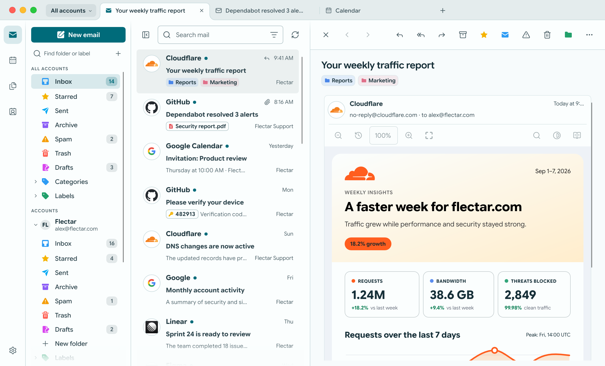
        </picture>
      </td>
      <td width="25%">
        <picture>
          <source media="(prefers-color-scheme: dark)" srcset="../../resources/screenshots/desktop-green-dark.png">
          <source media="(prefers-color-scheme: light)" srcset="../../resources/screenshots/desktop-green-light.png">
          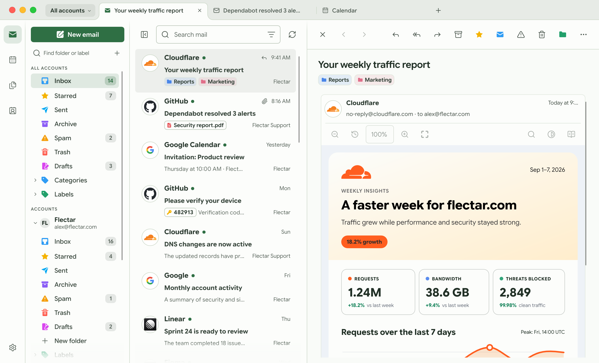
        </picture>
      </td>
      <td width="25%">
        <picture>
          <source media="(prefers-color-scheme: dark)" srcset="../../resources/screenshots/desktop-purple-dark.png">
          <source media="(prefers-color-scheme: light)" srcset="../../resources/screenshots/desktop-purple-light.png">
          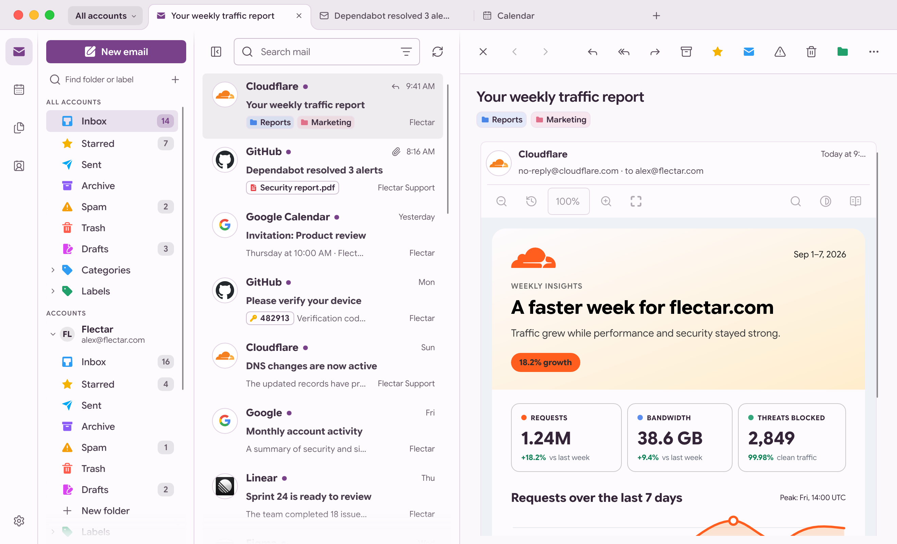
        </picture>
      </td>
      <td width="25%">
        <picture>
          <source media="(prefers-color-scheme: dark)" srcset="../../resources/screenshots/desktop-dark.png">
          <source media="(prefers-color-scheme: light)" srcset="../../resources/screenshots/desktop-light.png">
          
        </picture>
      </td>
    </tr>
  </tbody>
</table>

### Fenêtre sans bordure

<table>
  <tbody>
    <tr>
      <th width="50%">macOS</th>
      <th width="50%">Windows</th>
    </tr>
    <tr>
      <td width="50%">
        <picture>
          <source media="(prefers-color-scheme: dark)" srcset="../../resources/screenshots/frameless/macos-dark.png">
          <source media="(prefers-color-scheme: light)" srcset="../../resources/screenshots/frameless/macos-light.png">
          
        </picture>
      </td>
      <td width="50%">
        <picture>
          <source media="(prefers-color-scheme: dark)" srcset="../../resources/screenshots/frameless/windows-dark.png">
          <source media="(prefers-color-scheme: light)" srcset="../../resources/screenshots/frameless/windows-light.png">
          
        </picture>
      </td>
    </tr>
    <tr>
      <th width="50%">Linux (GNOME)</th>
      <th width="50%">Linux (KDE)</th>
    </tr>
    <tr>
      <td width="50%">
        <picture>
          <source media="(prefers-color-scheme: dark)" srcset="../../resources/screenshots/frameless/linux-gnome-dark.png">
          <source media="(prefers-color-scheme: light)" srcset="../../resources/screenshots/frameless/linux-gnome-light.png">
          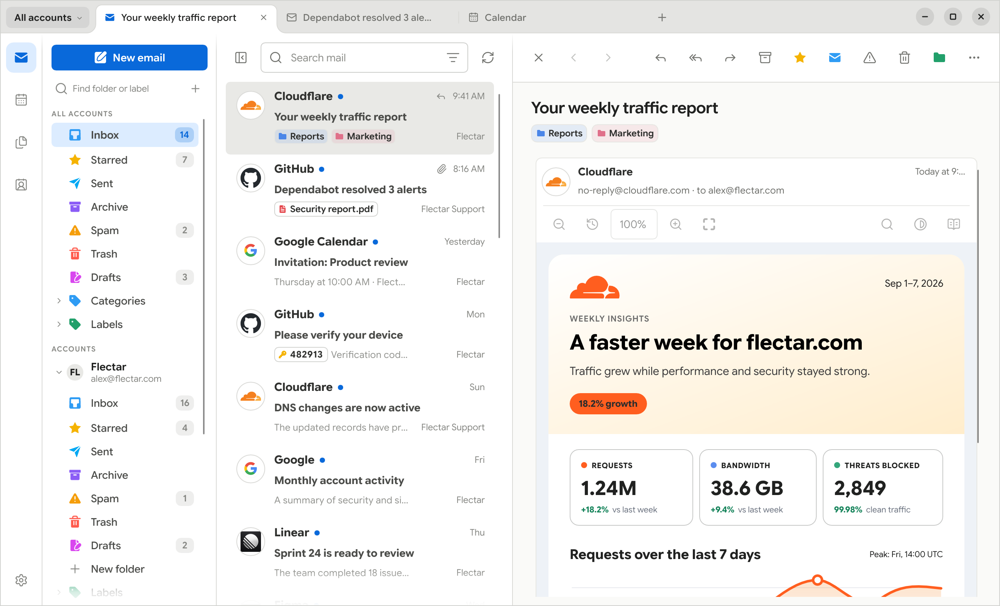
        </picture>
      </td>
      <td width="50%">
        <picture>
          <source media="(prefers-color-scheme: dark)" srcset="../../resources/screenshots/frameless/linux-kde-dark.png">
          <source media="(prefers-color-scheme: light)" srcset="../../resources/screenshots/frameless/linux-kde-light.png">
          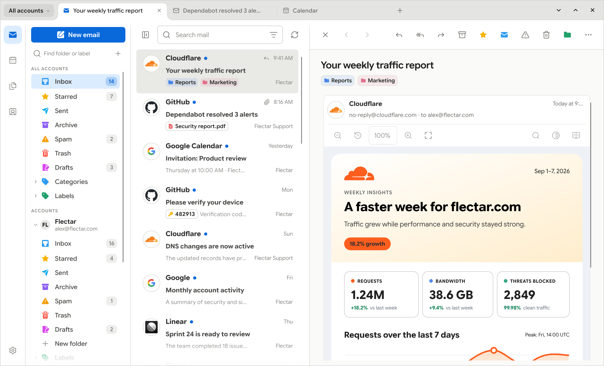
        </picture>
      </td>
    </tr>
  </tbody>
</table>

### Calendrier, contacts et fichiers

<table>
  <thead>
    <tr>
      <th width="33.33%">Calendrier</th>
      <th width="33.33%">Contacts</th>
      <th width="33.33%">Fichiers (WebDAV/JMAP)</th>
    </tr>
  </thead>
  <tbody>
    <tr>
      <td width="33.33%">
        <picture>
          <source media="(prefers-color-scheme: dark)" srcset="../../resources/screenshots/desktop-calendar-dark.png">
          <source media="(prefers-color-scheme: light)" srcset="../../resources/screenshots/desktop-calendar-light.png">
          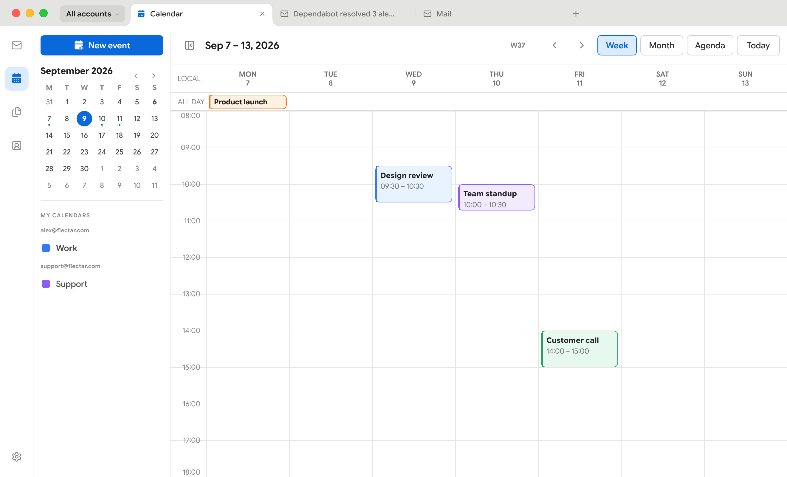
        </picture>
      </td>
      <td width="33.33%">
        <picture>
          <source media="(prefers-color-scheme: dark)" srcset="../../resources/screenshots/desktop-contacts-dark.png">
          <source media="(prefers-color-scheme: light)" srcset="../../resources/screenshots/desktop-contacts-light.png">
          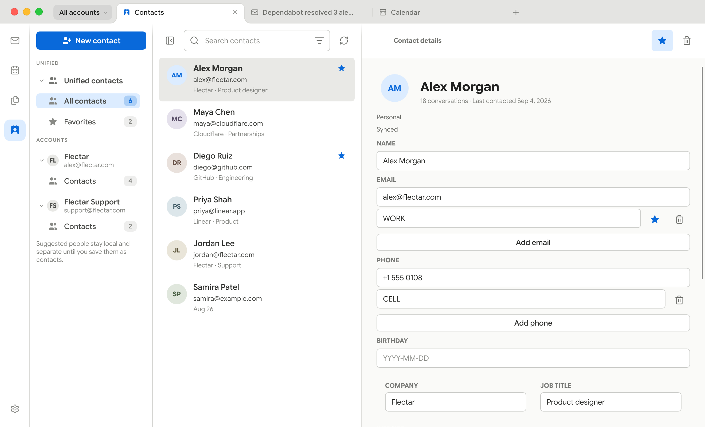
        </picture>
      </td>
      <td width="33.33%">
        <picture>
          <source media="(prefers-color-scheme: dark)" srcset="../../resources/screenshots/desktop-files-dark.png">
          <source media="(prefers-color-scheme: light)" srcset="../../resources/screenshots/desktop-files-light.png">
          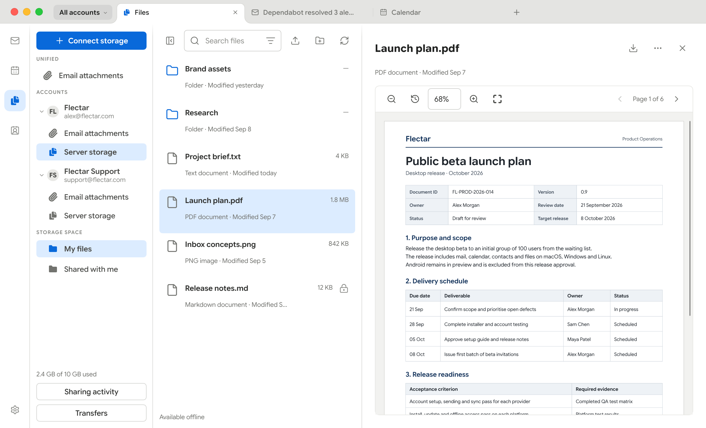
        </picture>
      </td>
    </tr>
  </tbody>
</table>

### Pour les petits écrans

| Clair | Sombre |
| --- | --- |
| 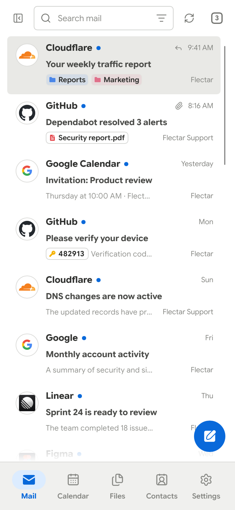 | 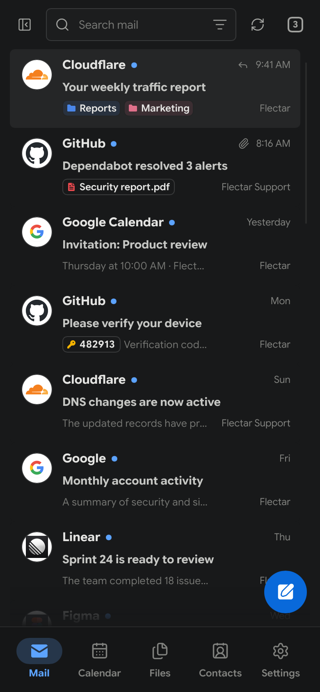 |

## 🧪 Rendu HTML expérimental

> [!WARNING]
> Le rendu des e-mails HTML est actuellement la partie la plus expérimentale de Flectar Mail. Certains messages, notamment ceux dont le balisage et le CSS sont complexes ou inhabituels, peuvent encore s’afficher incorrectement.

Flectar Mail affiche les e-mails avec [Blitz](https://github.com/DioxusLabs/blitz), un moteur HTML/CSS en Rust de l’équipe Dioxus, plutôt qu’en intégrant un navigateur ou une WebView. Si un message s’affiche incorrectement, [signalez-le](https://github.com/flectar/mail/issues). En savoir plus sur [le moteur de rendu et les options CPU et GPU](../features.md#html-rendering).

## 📥 Obtenir Flectar Mail

Flectar Mail est en cours de développement et n’est pas encore stable. Les versions de test sont disponibles sur [GitHub Releases](https://github.com/flectar/mail/releases).

> [!WARNING]
> **La vérification OAuth de Google exige une évaluation annuelle de sécurité CASA.** Flectar est un projet libre communautaire ; cette évaluation dépend donc du soutien des sponsors. Tant que la vérification requise n’est pas financée et terminée, une version stable avec OAuth Gmail configuré par défaut ne sera pas possible. Pour aider à proposer la connexion Gmail intégrée, [sponsorisez Flectar](https://github.com/sponsors/flectar).

| Plateforme | Téléchargement | Remarques |
| --- | --- | --- |
| Linux x64 et arm64 | AppImage, `.deb` pour Debian/Ubuntu, `.rpm` pour Fedora 43/44 ou paquet Flatpak | Nécessite un trousseau compatible Secret Service. Le Flatpak est une version de test à installer manuellement, pas encore disponible sur Flathub. |
| Windows x64 et arm64 | Installateur `.exe` ou ZIP portable | Préversions non signées |
| macOS 14+ (Apple silicon ou Intel) | DMG ou ZIP de l’application | Préversions avec signature ad hoc, non notariées |
| Android 8.0+ (arm64) | APK signé | Préversions et versions stables partagent une même identité d’application. |
| iOS 17+ (iPhone et iPad) | `.ipa` non signé | À installer avec AltStore, SideStore ou Sideloadly et votre identifiant Apple. |
| HarmonyOS et OpenHarmony | [Portage communautaire](../../platform/ohos/README.md) par [springmin](https://github.com/springmin) | Ne fait pas partie des publications GitHub ; à compiler à partir des sources. |

Dans les compilations sans clés d’application OAuth, la connexion Gmail et Outlook reste désactivée. Utilisez la roue dentée **Paramètres de connexion** de l’écran d’accueil pour ajouter votre propre inscription d’application Google ou Microsoft, ou connectez un compte IMAP, POP3 ou JMAP.

Le [guide d’installation](../install.md) couvre les commandes d’installation, le trousseau et le portail du bureau sur Linux, les remarques sur Flatpak et RPM, la vérification des téléchargements, la signature Android, l’installation sur iOS et la compilation à partir des sources avec `cargo run --bin flectar-mail`.

## 🤝 Participer

| Sujet | Détails |
| --- | --- |
| 🌍 **Traduire** | Traduisez l’application, améliorez une traduction ou relisez des textes traduits sur [Weblate](https://translate.flectar.com/) : aucune connaissance en programmation ou expérience de GitHub n’est nécessaire. Les traductions arrivent dans ce dépôt sous forme de pull requests, et les personnes qui contribuent sont créditées sur GitHub. Les traductions du README sont maintenues ici ; consultez [Contribuer aux traductions](../../CONTRIBUTING.md#translations). |
| ♿ **Accessibilité** | Navigation au clavier, thèmes clairs et sombres et dispositions flexibles ; le travail sur l’accessibilité se poursuit. Consultez [ACCESSIBILITY.md](../../ACCESSIBILITY.md) pour les fonctions actuelles, les limites des tests et la manière de signaler un obstacle. |
| 🔒 **Sécurité** | Signalez les vulnérabilités en privé en suivant [SECURITY.md](../../SECURITY.md), et n’en publiez pas les détails dans les signalements publics. |
| 🌐 **Logiciel libre** | Une seule application libre, sans édition communautaire séparée, distribuée sous [GNU Affero General Public License v3](../../LICENSE). La [présentation des licences](../../LICENSING.md) en donne les détails pratiques. |
| 🛠️ **Contribuer** | [CONTRIBUTING.md](../../CONTRIBUTING.md) explique comment participer au projet. |

## 🫡 Remerciements

Flectar Mail existe grâce au travail de ces projets et de leurs contributeurs :

- [Slint](https://slint.dev/), la boîte à outils d’interface native qui fait fonctionner l’interface de Flectar Mail.
- [Blitz](https://github.com/DioxusLabs/blitz), le moteur HTML/CSS en Rust de l’équipe Dioxus qui assure l’affichage des e-mails.

---
